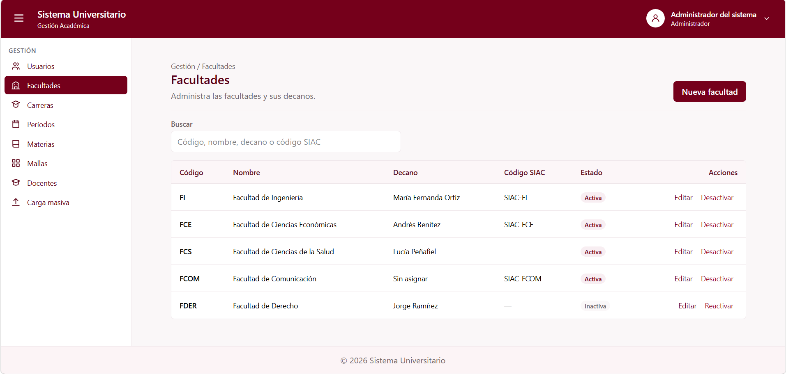
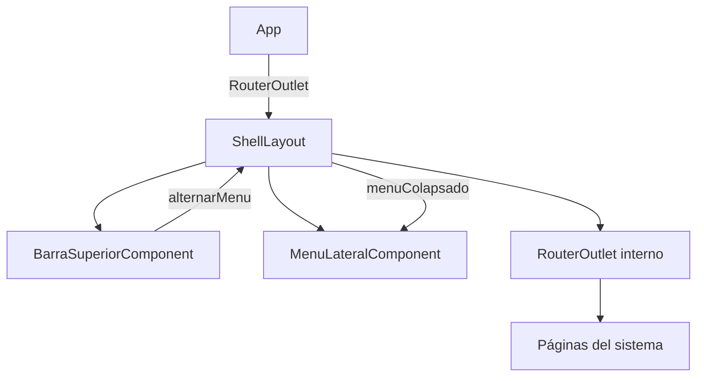

# Shell Layout (C1-01) — Cómo funciona

Documento de referencia del componente `app-shell-layout` y de su integración con `app-barra-superior`, `app-menu-lateral` y las páginas del sistema.

---

## 1. Qué es y qué hace

`app-shell-layout` es la estructura principal del Sistema Universitario. Funciona como contenedor de las páginas y organiza los elementos comunes de la aplicación.



Se encarga de:

1. **Mostrar** la barra superior del sistema (C1-03).
2. **Incorporar** el menú lateral de navegación (C1-02).
3. **Mostrar** las páginas correspondientes mediante `router-outlet`.
4. **Controlar** el estado expandido o colapsado del menú lateral.
5. **Mostrar** el pie de página del sistema.

| Dato | Valor |
| --- | --- |
| ID | C1-01 |
| Selector | `app-shell-layout` |
| Clase | `ShellLayout` |
| Tipo | Layout |
| Grupo dueño | G1 · Gestión (Maximilian Rivas) |
| Carpeta | `src/app/shared/components/shell-layout/` |
| Ruta | `/` (contenedor de rutas hijas) |
| Componentes hijos | `app-barra-superior`, `app-menu-lateral` |
| Estado interno | `menuColapsado: signal<boolean>` |
| `@Input` / `@Output` | No tiene entradas ni salidas propias |

---

## 2. Archivos

```text
src/app/
├── shared/components/
│   ├── shell-layout/
│   │   ├── shell-layout.ts          ← lógica y estado del menú lateral
│   │   ├── shell-layout.html        ← estructura general de la aplicación
│   │   ├── shell-layout.css         ← distribución y estilos responsive
│   │   ├── shell-layout.spec.ts     ← pruebas
│   │   └── README.md               ← documentación
│   │
│   └── menu-lateral/
│       ├── menu-lateral.ts          ← navegación lateral (C1-02)
│       └── menu-lateral.html
│
├── features/gestion/
│   ├── barra-superior/
│   │   ├── barra-superior.ts        ← encabezado del sistema (C1-03)
│   │   └── barra-superior.html
│   │
│   └── menu-usuario/
│       ├── menu-usuario.ts         ← opciones de cuenta (C1-04)
│       └── menu-usuario.html
│
├── app.routes.ts                   ← configura las rutas hijas del layout
├── app.ts                          ← componente raíz de Angular
└── app.html                        ← contiene el router-outlet principal
```

El componente combina CSS propio para la distribución y Tailwind CSS 4 para los colores y estilos visuales.

---

## 3. Cómo fluye la información



En palabras:

1. Angular utiliza `app.routes.ts` para cargar `ShellLayout` como contenedor principal.
2. El layout muestra la barra superior, el menú lateral y un área central.
3. Las rutas hijas se presentan dentro del `router-outlet` del layout.
4. Cuando el usuario presiona el botón de menú en `BarraSuperiorComponent`, se emite `alternarMenu`.
5. `ShellLayout` recibe el evento y modifica `menuColapsado`.
6. El nuevo estado se envía a `MenuLateralComponent`, que ajusta su ancho automáticamente.

El menú lateral y la barra superior no necesitan comunicarse directamente.

---

## 4. Cada pieza

### 4.1. `ShellLayout` — `shell-layout.ts`

El componente importa `RouterOutlet`, `MenuLateralComponent` y `BarraSuperiorComponent`.

Utiliza una signal de Angular para almacenar el estado del menú:

```ts
readonly menuColapsado = signal(false);
```

Cuando el valor es `false`, el menú aparece expandido. Cuando es `true`, se muestra colapsado.

El método encargado de cambiarlo es:

```ts
alternarMenu(): void {
  this.menuColapsado.update((valor) => !valor);
}
```

Este método se ejecuta cuando la barra superior emite el evento correspondiente.

### 4.2. Plantilla — `shell-layout.html`

La plantilla está organizada en cuatro partes:

- **Barra superior:** contiene `app-barra-superior`.
- **Menú lateral:** contiene `app-menu-lateral`.
- **Área principal:** contiene `router-outlet`.
- **Pie de página:** muestra el texto institucional.

La comunicación entre componentes se realiza así:

```html
<app-barra-superior (alternarMenu)="alternarMenu()" />
```

```html
<aside
  class="menu-lateral bg-surface"
  [class.menu-colapsado]="menuColapsado()"
>
  <app-menu-lateral [colapsado]="menuColapsado()" />
</aside>
```

Las páginas se muestran mediante:

```html
<main class="principal bg-background">
  <router-outlet></router-outlet>
</main>
```

### 4.3. Estilos — `shell-layout.css`

Utiliza Flexbox para distribuir verticalmente la barra superior, el contenido y el pie de página.

El contenido principal se divide entre el menú lateral y el área de trabajo.

El menú tiene dos anchos:

| Estado | Ancho |
| --- | --- |
| Expandido | 256 px |
| Colapsado | 64 px |

La clase `menu-colapsado` modifica el ancho del contenedor según el estado de la signal.

Los colores provienen de la paleta oficial definida en `src/styles.css`, utilizando clases como `bg-background`, `bg-surface`, `bg-header` y `text-text-secondary`.

### 4.4. Rutas — `app.routes.ts`

`ShellLayout` está configurado como componente de la ruta principal y contiene rutas hijas.

Entre las rutas disponibles actualmente en la configuración revisada están:

- `/acceso-denegado`
- `/gestion/facultades`
- `/gestion/periodos`
- `/gestion/carga-masiva`
- `/gestion/carga-masiva/bitacora`

Cada página se muestra dentro del `router-outlet` del layout sin reemplazar la barra superior ni el menú lateral.

---

## 5. Integración con otros componentes

### `BarraSuperiorComponent` (C1-03)

Ya está integrado en `shell-layout.html`.

Emite el evento `alternarMenu`, que permite expandir o colapsar el menú lateral.

La barra también incorpora `MenuUsuarioComponent` (C1-04), por lo que sus opciones de cuenta aparecen dentro del layout.

### `MenuLateralComponent` (C1-02)

Ya está integrado y recibe el estado `colapsado`.

El propio menú administra las opciones de navegación, los permisos y el resaltado de la ruta activa.

`ShellLayout` solamente controla su presentación expandida o colapsada.

### Páginas de los módulos

Las páginas de Gestión y de los demás módulos deben registrarse como rutas hijas de `ShellLayout` cuando corresponda.

No es necesario importar individualmente cada página dentro de `shell-layout.ts`.

---

## 6. Cómo verlo funcionando

Desde la terminal, en la raíz del proyecto, ejecutar:

```bash
npx ng serve
```

Abrir `http://localhost:4200`.

Pruebas rápidas:

- Verificar que se muestre la barra superior.
- Comprobar que aparezca el menú lateral.
- Presionar el botón de tres líneas: el menú debe colapsarse.
- Volver a presionarlo: el menú debe expandirse.
- Seleccionar una página del menú y comprobar que aparezca en el área central.
- Abrir el menú de usuario desde la barra superior.
- Verificar que el pie de página permanezca dentro de la estructura general.

El componente se ha verificado manualmente junto con las páginas existentes y su compilación en Angular.

---

## 7. Pruebas

`shell-layout.spec.ts` contiene una prueba básica de creación del componente.

Se recomienda ampliar las pruebas para verificar:

1. El componente se crea correctamente.
2. Se muestran `BarraSuperiorComponent` y `MenuLateralComponent`.
3. Existe el `router-outlet` interno.
4. `menuColapsado` inicia en `false`.
5. `alternarMenu()` cambia correctamente el estado.
6. El estado se transmite al menú lateral.
7. Las rutas hijas se muestran dentro del layout.

Para ejecutar las pruebas:

```bash
npx ng test
```

Para verificar la compilación:

```bash
npx ng build
```

Los casos adicionales son recomendaciones; no se encuentran todos implementados en el archivo de pruebas actual.

---

## 8. Pendientes y advertencias

| Tema | Detalle |
| --- | --- |
| **Autenticación** | Actualmente las rutas revisadas no tienen un guard de autenticación. Cuando exista `AuthService`, configurar la protección en `app.routes.ts` para impedir el acceso a las páginas privadas sin sesión válida. |
| **Login** | La página `/login` deberá estar fuera de las rutas hijas protegidas de `ShellLayout`, para mostrarla sin el menú ni la barra superior. Modificar `app.routes.ts` cuando se implemente C1-05. |
| **Menú móvil** | El CSS contiene reglas responsive, pero todavía falta implementar un menú lateral tipo drawer en pantallas pequeñas. Modificar `shell-layout.ts`, `.html` y `.css`. |
| **Selección en móvil** | `MenuLateralComponent` emite `navegar`. Puede conectarse en `shell-layout.html` para cerrar el drawer al seleccionar una página. |
| **Datos de usuario** | C1-03 utiliza temporalmente `usuarioPrueba`. Este dato no está definido en `ShellLayout`; deberá reemplazarse por información de `AuthService` en `barra-superior.ts`. |
| **Pie de página** | El texto `© 2026 Sistema Universitario` está escrito directamente en `shell-layout.html`. Actualizarlo si cambia el nombre institucional o se requiere un año dinámico. |
| **Rutas nuevas** | Registrar las nuevas páginas en `app.routes.ts` como rutas hijas cuando deban utilizar el layout. |
| **Notificaciones** | La campana del grupo G5 se integrará en C1-03, sin necesidad de modificar directamente `ShellLayout`. |

**Estado actual:** estructura principal funcional, con barra superior, menú lateral, navegación y pie de página integrados. Permanecen pendientes la protección por autenticación y el menú móvil desplegable.