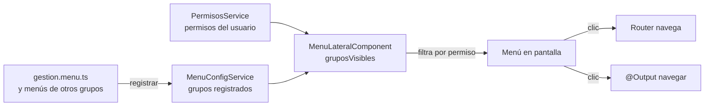
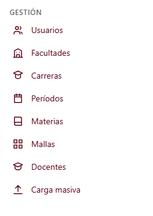

# Menú lateral (C1-02) — Cómo funciona

Documento de referencia del componente `app-menu-lateral` y de las piezas que lo rodean.
Pensado para que cualquier grupo (G1 a G5) pueda registrar sus opciones sin tocar el componente.

---

## 1. Qué es y qué hace

`app-menu-lateral` es la barra de navegación del sistema. Muestra las opciones **agrupadas por módulo**
(Gestión, Planificación, Horarios, etc.) y se encarga de tres cosas:

1. **Leer** una configuración común de menú (ruta, ícono, etiqueta, permiso requerido).
2. **Ocultar** las opciones a las que el usuario no tiene acceso, y los grupos que quedan vacíos.
3. **Resaltar** la opción de la página actual.

| Dato                | Valor                                                  |
| ------------------- | ------------------------------------------------------ |
| ID                  | C1-02                                                  |
| Selector            | `app-menu-lateral`                                     |
| Clase               | `MenuLateralComponent`                                 |
| Grupo dueño         | G1 · Gestión (Jose Luis Hidalgo)                       |
| Carpeta             | `src/app/shared/components/menu-lateral/`              |
| Se usa dentro de    | `app-shell-layout` (C1-01, pendiente)                  |
| `@Input`            | `colapsado: boolean` (por defecto `false`)             |
| `@Output`           | `navegar: string` (emite la ruta seleccionada)         |

---

## 2. Archivos

```
src/
├── app/
│   ├── app.config.ts                       ← registra el menú de Gestión al arrancar
│   ├── app.ts / app.html                   ← TEMPORAL: monta el menú y simula permisos
│   └── shared/
│       ├── models/
│       │   └── menu.model.ts               ← tipos MenuItem y MenuGrupo
│       ├── services/
│       │   ├── menu-config.service.ts      ← configuración común (los grupos se registran aquí)
│       │   └── permisos.service.ts         ← permisos del usuario actual
│       └── components/menu-lateral/
│           ├── menu-lateral.ts             ← lógica del componente
│           ├── menu-lateral.html           ← plantilla (Tailwind)
│           ├── iconos-menu.ts              ← catálogo de íconos SVG
│           └── menu-lateral.spec.ts        ← 8 pruebas
└── modules/
    └── gestion/
        └── gestion.menu.ts                 ← opciones de menú del módulo Gestión
```

---

## 3. Cómo fluye la información



En palabras:

1. Al arrancar, `app.config.ts` ejecuta un inicializador que llama a `MenuConfigService.registrar(MENU_GESTION)`.
2. El componente combina dos fuentes: **los grupos registrados** y **los permisos del usuario**.
3. Con ellas calcula `gruposVisibles`: para cada grupo deja solo las opciones permitidas y descarta los grupos sin opciones.
4. La plantilla dibuja ese resultado. Al hacer clic, `routerLink` navega y además se emite `navegar`.

Todo usa **signals** de Angular. Si los permisos cambian después (por ejemplo, tras iniciar sesión), el menú se actualiza solo, sin código extra.

---

## 4. Cada pieza

### 4.1 Modelos — `menu.model.ts`

```ts
interface MenuItem {
  etiqueta: string;   // texto visible
  ruta: string;       // ej. '/gestion/usuarios'
  icono: string;      // nombre en ICONOS_MENU
  permiso?: string;   // si se omite, lo ve cualquier usuario
}

interface MenuGrupo {
  id: string;         // único, ej. 'gestion'
  etiqueta: string;   // título del grupo
  orden: number;      // menor = más arriba
  items: MenuItem[];
}
```

### 4.2 `MenuConfigService`

Guarda los grupos registrados.

- `registrar(grupo)`: agrega un grupo. Si ya existe uno con el mismo `id`, **lo reemplaza** (evita duplicados).
- `grupos`: signal de solo lectura con los grupos **ordenados por `orden`**.

### 4.3 `PermisosService`

Guarda los permisos del usuario autenticado.

- `establecer(['usuario.ver', ...])`: define los permisos.
- `limpiar()`: los borra (para cerrar sesión).
- `tiene(permiso?)`: devuelve `true` si no se pide permiso, o si el usuario lo tiene.

> **Es temporal.** Hoy se llena a mano. Cuando exista el login, debe llenarse con los permisos que
> devuelva el backend (rol → permisos). La API pública (`establecer`, `tiene`) no debería cambiar,
> así el menú no se entera del cambio.

### 4.4 `MenuLateralComponent`

- `colapsado = input(false)`: si es `true`, muestra solo íconos (ancho `w-16` en vez de `w-64`).
- `navegar = output<string>()`: emite la ruta al hacer clic. Sirve al padre para, por ejemplo,
  cerrar el menú en móvil. **La navegación real la hace `routerLink`**, no este evento.
- `gruposVisibles`: `computed` que filtra por permisos y elimina grupos vacíos.

### 4.5 Plantilla y accesibilidad

- `<nav aria-label="Navegación principal">` con una `<section>` por grupo y un `<h2>` por título.
- La opción activa recibe las clases `bg-indigo-600 text-white` y `aria-current="page"`.
- En modo colapsado, las etiquetas pasan a `sr-only` (siguen disponibles para lectores de pantalla)
  y cada enlace muestra un `title` como tooltip.

### 4.6 Íconos — `iconos-menu.ts`

Íconos SVG simples (24×24, trazo). Disponibles:

`inicio`, `usuarios`, `facultades`, `carreras`, `periodos`, `materias`, `mallas`, `docentes`,
`carga`, `planificacion`, `horarios`, `reservas`, `reportes`, `menu`.

Si un `icono` no existe, se muestra un ícono por defecto (círculo con "!") en vez de dejar un hueco.
Para agregar uno: añade su trazo `d` al objeto `ICONOS_MENU` y úsalo por nombre.

---

## 5. Cómo registrar el menú de tu módulo (G2 a G5)

No se modifica el componente. Son dos pasos.

**Paso 1.** Crea `src/modules/<tu-modulo>/<tu-modulo>.menu.ts`:

```ts
import { MenuGrupo } from '../../app/shared/models/menu.model';

export const MENU_PLANIFICACION: MenuGrupo = {
  id: 'planificacion',
  etiqueta: 'Planificación',
  orden: 2,                       // Gestión usa 1
  items: [
    {
      etiqueta: 'Carga docente',
      ruta: '/planificacion/carga-docente',
      icono: 'planificacion',
      permiso: 'carga.ver',
    },
  ],
};
```

**Paso 2.** Regístralo en `src/app/app.config.ts`:

```ts
provideAppInitializer(() => {
  const menu = inject(MenuConfigService);
  menu.registrar(MENU_GESTION);
  menu.registrar(MENU_PLANIFICACION);   // ← tu línea
}),
```

Reglas:
- El `id` del grupo debe ser único. Usa el nombre de tu módulo.
- Elige un `orden` distinto para que los grupos no se mezclen.
- Cada `ruta` debe existir en el router (ver sección 8).
- Los códigos de `permiso` deben coincidir con los de la tabla de permisos.

---

## 6. Cómo verlo funcionando (modo temporal)

Mientras no exista `app-shell-layout`, `app.ts` y `app.html` montan el menú y simulan un usuario:

```ts
// app.ts
inject(PermisosService).establecer(['usuario.ver', 'carrera.ver', /* ... */]);
```

```html
<!-- app.html -->
<div class="flex h-screen">
  <app-menu-lateral />
  <main class="flex-1 overflow-auto p-6"><router-outlet /></main>
</div>
```

Pruebas rápidas:
- Deja solo `'usuario.ver'` en la lista: el menú muestra únicamente **Usuarios**.
- Deja la lista vacía: el menú queda vacío.
- Cambia a `<app-menu-lateral [colapsado]="true" />`: solo íconos.

Ejecuta `npm start` y abre `http://localhost:4200`.

---

## 7. Pruebas

`menu-lateral.spec.ts` cubre 8 casos:

1. Muestra solo las opciones permitidas.
2. Oculta los grupos que quedan sin opciones.
3. Muestra todos los grupos, en orden, con todos los permisos.
4. No muestra nada sin permisos.
5. Una opción sin permiso requerido es visible para todos.
6. Resalta la opción activa (`aria-current="page"`).
7. Emite `navegar` con la ruta al hacer clic.
8. En modo colapsado oculta etiquetas visualmente pero las deja para lectores de pantalla.

Ejecutar: `npm test`.

---

## 8. Pendientes y advertencias

| Tema | Detalle |
| ---- | ------- |
| **Ocultar no es proteger** | Esconder una opción solo mejora la experiencia. Quien conozca la URL puede escribirla. La seguridad real son los **guards de ruta** y la validación del **backend**. |
| **Permisos provisionales** | Los códigos (`usuario.ver`, `carrera.ver`...) los propuse yo. Hay que fijarlos con el grupo antes de que otros los copien. |
| **`PermisosService` temporal** | Se llena a mano en `app.ts`. Debe conectarse al login (T-04 / G1-02). |
| **Rutas sin definir** | `app.routes.ts` está vacío. Hasta que existan las páginas, un clic en el menú dará error de ruta no encontrada. |
| **`app.ts` / `app.html` temporales** | Cuando se construya `app-shell-layout` (C1-01), este debe contener el menú y el `<router-outlet>`, y se quitan los permisos simulados. |
| **Íconos propios** | Son dibujos simples hechos a mano. Si prefieren una librería, solo cambia `iconos-menu.ts`. |


