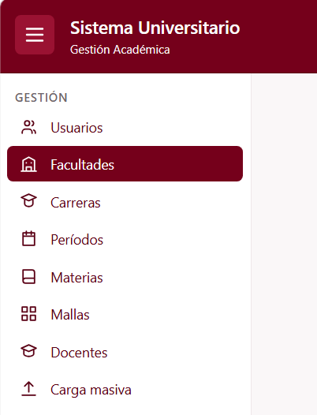
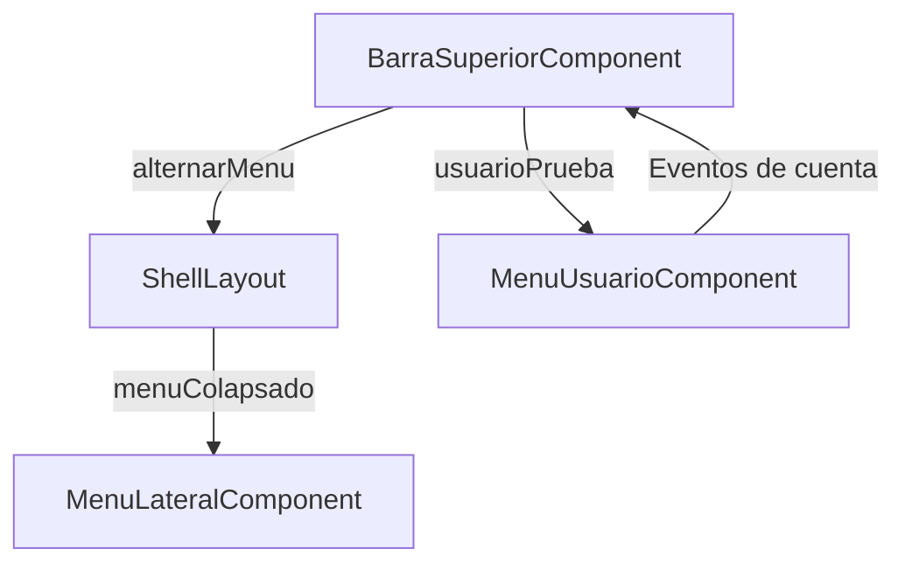

# Barra superior (C1-03) — Cómo funciona

Documento de referencia del componente `app-barra-superior` y de su integración con `app-shell-layout` y `app-menu-usuario`.

---

## 1. Qué es y qué hace

`app-barra-superior` es el encabezado principal del Sistema Universitario. Se encarga de:



1. **Mostrar** el nombre del sistema y del módulo.
2. **Expandir o colapsar** el menú lateral mediante un botón.
3. **Incorporar** el menú desplegable del usuario (C1-04).
4. **Recibir** las solicitudes de cambio de contraseña y cierre de sesión.

| Dato | Valor |
| --- | --- |
| ID | C1-03 |
| Selector | `app-barra-superior` |
| Clase | `BarraSuperiorComponent` |
| Grupo dueño | G1 · Gestión (Maximilian Rivas) |
| Carpeta | `src/app/features/gestion/barra-superior/` |
| Se usa dentro de | `app-shell-layout` (C1-01) |
| Componente hijo | `app-menu-usuario` (C1-04) |
| `@Output` | `alternarMenu: void` |

---

## 2. Archivos

```text
src/app/
├── features/gestion/
│   ├── barra-superior/
│   │   ├── barra-superior.ts       ← lógica, eventos y usuario temporal
│   │   ├── barra-superior.html     ← plantilla con Tailwind CSS 4
│   │   ├── barra-superior.spec.ts  ← pruebas
│   │   └── README.md              ← documentación
│   └── menu-usuario/
│       ├── menu-usuario.ts         ← lógica del desplegable
│       └── menu-usuario.html       ← opciones de cuenta
└── shared/components/
    └── shell-layout/
        ├── shell-layout.ts         ← controla el estado del menú
        └── shell-layout.html       ← contiene la barra superior
```

No se utiliza un archivo CSS propio porque los estilos están implementados con Tailwind CSS 4.

---

## 3. Cómo fluye la información



En palabras:

1. El botón de la barra ejecuta `toggleMenu()` y emite `alternarMenu`.
2. `ShellLayout` recibe el evento, actualiza su signal `menuColapsado` y transmite el valor al menú lateral.
3. La barra superior envía un usuario temporal a `MenuUsuarioComponent`.
4. El menú de usuario emite eventos de cambio de contraseña y cierre de sesión que recibe la barra superior.

---

## 4. Cada pieza

### 4.1. `BarraSuperiorComponent`

Utiliza `output()` para comunicar al componente padre que debe cambiar el estado del menú.

```ts
readonly alternarMenu = output<void>();

toggleMenu(): void {
  this.alternarMenu.emit();
}
```

También incorpora `MenuUsuarioComponent` mediante `imports`.

### 4.2. Plantilla — `barra-superior.html`

Contiene el botón de navegación, el título del sistema y el menú de usuario.

```html
<app-menu-usuario
  [usuario]="usuarioPrueba"
  (solicitarCambioContrasena)="solicitarCambioContrasena()"
  (solicitarCierreSesion)="solicitarCierreSesion()"
/>
```

El diseño utiliza los colores oficiales definidos en `src/styles.css`, con un fondo vino oscuro `bg-primary`, textos claros `text-surface`y efectos de interacción `hover:bg-accent`.

### 4.3. Acciones de cuenta

Actualmente existen dos métodos receptores:

```ts
solicitarCambioContrasena(): void {
}

solicitarCierreSesion(): void {
}
```

Todavía no ejecutan operaciones reales. Se completarán cuando estén disponibles las funciones de autenticación.

---

## 5. Integración con otros componentes

### `ShellLayout` (C1-01)

Contiene la barra superior y recibe su evento:

```html
<app-barra-superior (alternarMenu)="alternarMenu()" />
```

`ShellLayout` actualiza `menuColapsado`, que controla el tamaño de `app-menu-lateral`.

### `MenuUsuarioComponent` (C1-04)

Ya está integrado. Recibe el usuario temporal y presenta el desplegable con las opciones de cuenta.

Los botones funcionan visualmente, pero sus acciones reales están pendientes.

### `CampanaNotificacionesComponent` (G5)

Todavía no está integrado. Deberá incorporarse en el extremo derecho de `barra-superior.html`, antes de `app-menu-usuario`.

---

## 6. Cómo verlo funcionando

Ejecuta:

```bash
npx ng serve
```

Abre `http://localhost:4200`.

Pruebas rápidas:

- Presionar el botón de tres líneas: el menú lateral se colapsa.
- Volver a presionarlo: el menú se expande.
- Abrir el menú de usuario: aparecen sus datos y opciones de cuenta.
- Navegar entre las páginas existentes: deben continuar mostrándose dentro de `ShellLayout`.

---

## 7. Pruebas

`barra-superior.spec.ts` es el archivo de pruebas del componente.

Casos que se deben verificar:

1. El componente se crea correctamente.
2. Muestra el título del sistema.
3. Emite `alternarMenu` cuando se presiona el botón.
4. Incorpora `MenuUsuarioComponent`.
5. Envía correctamente los datos del usuario al componente hijo.

Estos casos son pruebas recomendadas; no se ha confirmado que todos estén automatizados.

Ejecutar:

```bash
npx ng test
npx ng build
```

---

## 8. Pendientes y advertencias

| Tema | Detalle |
| --- | --- |
| **Usuario temporal** | `usuarioPrueba` está declarado en `barra-superior.ts`. Debe eliminarse y reemplazarse por el usuario autenticado obtenido desde `AuthService`. |
| **Cambio de contraseña** | Completar `solicitarCambioContrasena()` en `barra-superior.ts` para conectar la pantalla o funcionalidad correspondiente. |
| **Cerrar sesión** | Completar `solicitarCierreSesion()` en `barra-superior.ts` utilizando `AuthService` y coordinando la limpieza de permisos y la navegación. |
| **Notificaciones G5** | Importar el componente de notificaciones en `barra-superior.ts`, agregarlo a `imports` e incorporarlo en `barra-superior.html` antes del menú de usuario. |
| **Diseño móvil** | Completar el comportamiento de menú desplegable en `shell-layout.ts`, `.html` y `.css`. |
| **Textos estáticos** | El nombre del sistema y del módulo están escritos en `barra-superior.html`. Actualizarlos si cambian sus nombres oficiales. |

**Estado actual:** barra superior funcional, con menú lateral y C1-04 integrados. Permanecen pendientes la autenticación real y las notificaciones.