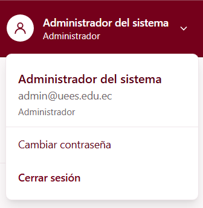
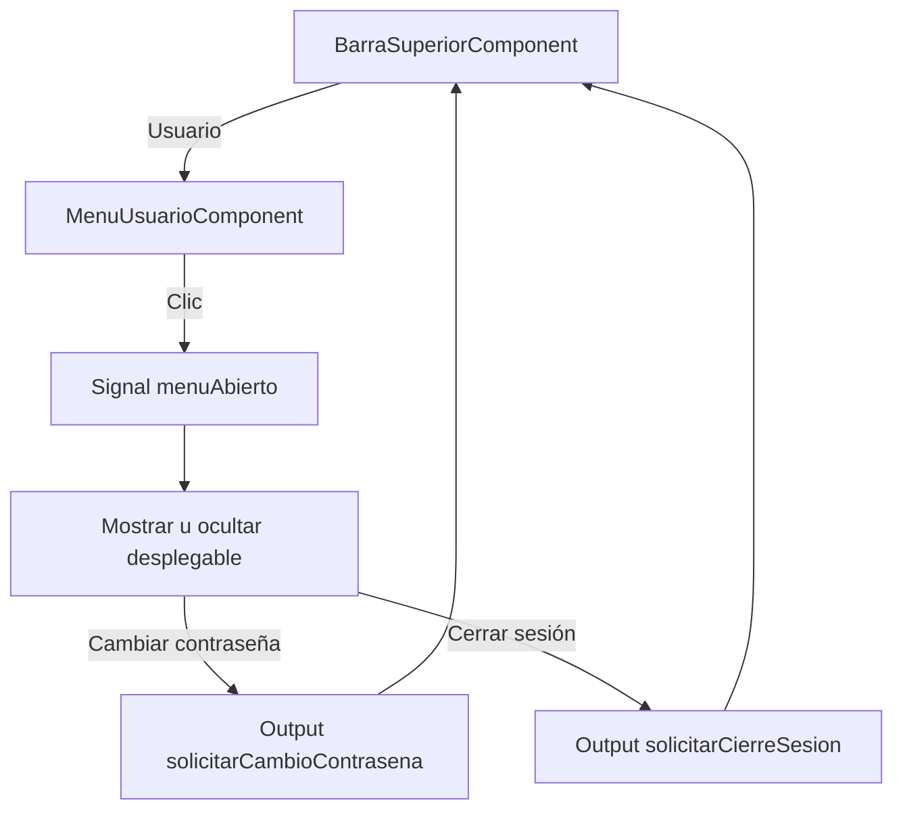

# Menú de usuario (C1-04) — Cómo funciona

Documento de referencia del componente `app-menu-usuario`, encargado de mostrar los datos del usuario y las opciones de cuenta dentro de `app-barra-superior`.

---

## 1. Qué es y qué hace

`app-menu-usuario` es un menú desplegable ubicado en el extremo derecho de la barra superior.



Se encarga de:

1. **Mostrar** el nombre y roles del usuario.
2. **Abrir y cerrar** un menú desplegable.
3. **Mostrar** el correo electrónico y las opciones de cuenta.
4. **Emitir eventos** al seleccionar Cambiar contraseña o Cerrar sesión.

| Dato | Valor |
| --- | --- |
| ID | C1-04 |
| Selector | `app-menu-usuario` |
| Clase | `MenuUsuarioComponent` |
| Grupo dueño | G1 · Gestión (Maximilian Rivas) |
| Carpeta | `src/app/features/gestion/menu-usuario/` |
| Se usa dentro de | `app-barra-superior` (C1-03) |
| `@Input` | `usuario: Usuario \| null` |
| `@Output` | `solicitarCambioContrasena: void` |
| `@Output` | `solicitarCierreSesion: void` |

---

## 2. Archivos

```text
src/app/
├── features/gestion/
│   ├── menu-usuario/
│   │   ├── menu-usuario.ts          ← lógica del menú y eventos
│   │   ├── menu-usuario.html        ← desplegable con Tailwind CSS 4
│   │   ├── menu-usuario.spec.ts     ← pruebas
│   │   └── README.md               ← documentación
│   └── barra-superior/
│       ├── barra-superior.ts        ← proporciona usuarioPrueba
│       └── barra-superior.html      ← utiliza app-menu-usuario
└── shared/models/
    └── usuario.model.ts             ← interfaz Usuario
```

No se utiliza un archivo CSS propio. Los estilos se aplican mediante Tailwind CSS 4.

---

## 3. Cómo fluye la información



En palabras:

1. `BarraSuperiorComponent` proporciona un objeto `Usuario` mediante `input()`.
2. El menú presenta el nombre y roles recibidos.
3. Al presionar el botón, la signal `menuAbierto` controla la visibilidad del desplegable.
4. Las opciones de cuenta emiten eventos hacia `BarraSuperiorComponent`, que deberá ejecutar las acciones reales.

---

## 4. Cada pieza

### 4.1. `MenuUsuarioComponent`

Recibe un usuario y administra el estado del desplegable:

```ts
readonly usuario = input<Usuario | null>(null);
readonly menuAbierto = signal(false);

alternarMenu(): void {
  this.menuAbierto.update(valor => !valor);
}
```

Define dos eventos:

```ts
readonly solicitarCambioContrasena = output<void>();
readonly solicitarCierreSesion = output<void>();
```

Los métodos `cambiarContrasena()` y `cerrarSesion()` cierran el desplegable y emiten el evento correspondiente.

No realizan directamente operaciones de autenticación.

### 4.2. Plantilla — `menu-usuario.html`

Contiene:

- Botón con ícono, nombre y roles.
- Panel con nombre, correo electrónico y roles.
- Opciones Cambiar contraseña y Cerrar sesión.

El desplegable se muestra mediante:

```html
@if (menuAbierto()) {
  <!-- Opciones de cuenta -->
}
```

El botón de usuario utiliza textos e íconos claros `text-surface` para mantener la legibilidad sobre la barra superior color vino. El menú desplegable conserva su fondo blanco `bg-surface` y textos oscuros `text-primary-dark`

Si no existe un usuario, aparecen textos alternativos y los botones de cuenta permanecen deshabilitados mediante `[disabled]="!usuario()"`.

### 4.3. Modelo `Usuario`

El componente utiliza `Usuario` desde `shared/models/usuario.model.ts`.

Los atributos que muestra son `nombres`, `email` y `roles`. No requiere un modelo adicional.

---

## 5. Integración con otros componentes

### `BarraSuperiorComponent` (C1-03)

Importa `MenuUsuarioComponent` y lo incorpora en su plantilla:

```html
<app-menu-usuario
  [usuario]="usuarioPrueba"
  (solicitarCambioContrasena)="solicitarCambioContrasena()"
  (solicitarCierreSesion)="solicitarCierreSesion()"
/>
```

El componente padre proporciona los datos y recibe las acciones.

### `AuthService` (pendiente)

Cuando exista, permitirá obtener el usuario autenticado y ejecutar el cierre de sesión real.

`UsuarioService` no debe utilizarse para determinar automáticamente quién inició sesión, porque su responsabilidad es administrar registros de usuarios.

---

## 6. Cómo verlo funcionando

Ejecuta:

```bash
npx ng serve
```

Abre `http://localhost:4200`.

Pruebas rápidas:

- Verificar que aparezcan el nombre y rol del usuario de prueba.
- Presionar el botón de usuario: aparece el desplegable.
- Comprobar que se muestre el correo electrónico.
- Verificar las opciones Cambiar contraseña y Cerrar sesión.
- Volver a presionar el botón: el menú se cierra.
- Seleccionar una opción: el desplegable se cierra y emite su evento.

Las opciones todavía no modifican contraseñas ni finalizan sesiones reales.

---

## 7. Pruebas

`menu-usuario.spec.ts` es el archivo de pruebas del componente.

Casos que se deben verificar:

1. El componente se crea correctamente.
2. Muestra los datos del usuario recibido.
3. Abre y cierra el desplegable.
4. Emite `solicitarCambioContrasena` al seleccionar la opción correspondiente.
5. Emite `solicitarCierreSesion` al seleccionar Cerrar sesión.
6. Deshabilita las acciones cuando `usuario` es `null`.

Estos son casos recomendados; no se ha confirmado que todos estén automatizados.

Ejecutar:

```bash
npx ng test
npx ng build
```

---

## 8. Pendientes y advertencias

| Tema | Detalle |
| --- | --- |
| **Usuario quemado** | El objeto `usuarioPrueba` está en `barra-superior.ts`, no en C1-04. Debe eliminarse al integrar `AuthService`. |
| **Reemplazar datos** | En `barra-superior.html`, cambiar `[usuario]="usuarioPrueba"` por la propiedad o signal que contenga el usuario autenticado. |
| **Cambio de contraseña** | `cambiarContrasena()` solo emite un evento. Completar `solicitarCambioContrasena()` en `barra-superior.ts` y conectarlo con la funcionalidad real. |
| **Cerrar sesión** | `cerrarSesion()` solo emite un evento. Completar `solicitarCierreSesion()` en `barra-superior.ts` utilizando `AuthService`. |
| **Cierre del desplegable** | Todavía falta permitir cerrar el menú con Escape o haciendo clic fuera. Modificar `menu-usuario.ts` y, si es necesario, `menu-usuario.html`. |
| **Accesibilidad** | Revisar el manejo del foco y la navegación mediante teclado. |
| **Autenticación** | Hasta que se implemente la sesión real, los datos mostrados son únicamente de prueba. |

**Estado actual:** menú desplegable funcional e integrado con C1-03. Permanecen pendientes la autenticación y las acciones reales de cuenta.