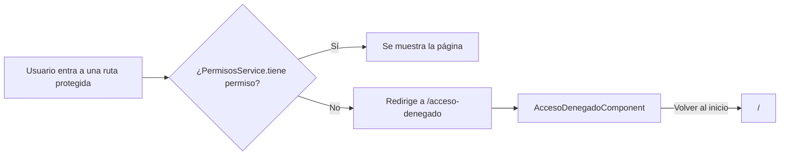
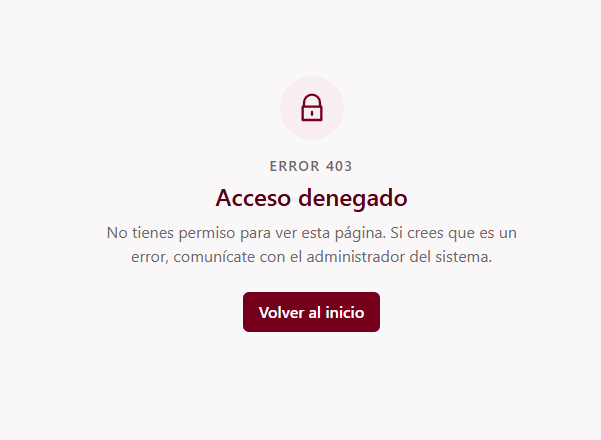

# Pantalla de acceso denegado (C1-07)

Guía para los grupos G2 a G5. Explica qué es esta pantalla, cómo se llega a ella y cómo
redirigir a ella desde tus rutas protegidas.

---

## 1. Qué es

Es la **pantalla 403**. Se muestra cuando un usuario intenta entrar a una página para la
que su rol **no tiene permiso**. Informa qué pasó y ofrece un botón para volver al inicio.

| Dato             | Valor                                                        |
| ---------------- | ------------------------------------------------------------ |
| ID               | C1-07                                                        |
| Selector         | `app-acceso-denegado`                                        |
| Clase            | `AccesoDenegadoComponent`                                    |
| Tipo             | Página (tiene ruta propia)                                   |
| **Ruta**         | **`/acceso-denegado`**                                       |
| Grupo dueño      | G1 · Gestión                                                 |
| Carpeta          | `src/app/shared/components/acceso-denegado/`                 |
| `@Input` / `@Output` | Ninguno                                                  |

Lo que ve el usuario: un candado, "ERROR 403", el título **Acceso denegado**, un mensaje
("No tienes permiso para ver esta página...") y el botón **Volver al inicio** (lleva a `/`).

---

## 2. Cómo usarla en tu módulo

**No importas el componente ni lo pones en tus plantillas.** Es una página que ya tiene su
ruta. Lo único que haces es **redirigir a `/acceso-denegado`** cuando el usuario no tenga
permiso.

La forma recomendada es un **guard de ruta**.

### 2.1 Ejemplo de guard

> Este guard es un **ejemplo**: todavía no existe en el proyecto. Se probó con el
> `PermisosService` actual, pero cualquier grupo puede crear el suyo o ponerse de acuerdo
> para tener uno común.

```ts
import { inject } from '@angular/core';
import { CanActivateFn, Router } from '@angular/router';
import { PermisosService } from '../../app/shared/services/permisos.service';

export const permisoGuard =
  (permiso: string): CanActivateFn =>
  () => {
    const permisos = inject(PermisosService);
    const router = inject(Router);
    return permisos.tiene(permiso) ? true : router.createUrlTree(['/acceso-denegado']);
  };
```

### 2.2 Aplicarlo a tus rutas

```ts
{
  path: 'gestion/carreras',
  component: CarrerasListaComponent,
  canActivate: [permisoGuard('carrera.ver')],
}
```

Si el usuario no tiene el permiso `carrera.ver`, Angular lo manda a `/acceso-denegado`.
Si lo tiene, entra normal.

### 2.3 Redirigir desde código (sin guard)

```ts
private readonly router = inject(Router);

this.router.navigate(['/acceso-denegado']);
```

Usa siempre la ruta **absoluta** (`/acceso-denegado`, con la barra inicial), para que funcione
sin importar desde qué módulo se llame.

---

## 3. Cómo se conecta con el resto



- La ruta está declarada en `src/app/app.routes.ts`, como **hija de `ShellLayout`**. Por eso la
  pantalla 403 se ve **dentro del layout** (con su barra, menú y pie), no suelta.
- Los permisos vienen de `PermisosService` (el mismo que usa el menú lateral).

---

## 4. Archivos

```
src/app/
├── app.routes.ts                          ← declara la ruta /acceso-denegado
└── shared/components/acceso-denegado/
    ├── acceso-denegado.ts                 ← clase del componente
    ├── acceso-denegado.html               ← plantilla (Tailwind, paleta oficial)
    └── acceso-denegado.spec.ts            ← 5 pruebas
```

---

## 5. Pruebas

`acceso-denegado.spec.ts` verifica 5 cosas:

1. Muestra el título "Acceso denegado" y el código 403.
2. Muestra el mensaje de que no tiene permiso.
3. El botón dice "Volver al inicio" y apunta a `/`.
4. La sección está asociada a su título (accesibilidad).
5. La ruta `/acceso-denegado` realmente muestra esta pantalla.

Ejecutar: `npm test`.

---

## 6. Probarlo a mano

1. Corre `npm start`.
2. Abre `http://localhost:4200/acceso-denegado`.
3. Debes ver la pantalla 403 y, al pulsar **Volver al inicio**, regresar a `/`.

---

## 7. Advertencias y pendientes

| Tema | Detalle |
| ---- | ------- |
| **Ocultar/redirigir no es proteger** | El guard mejora la experiencia, pero la seguridad real está en el **backend**. Un usuario con conocimientos podría saltarse el front. El backend debe validar los permisos y responder 403. |
| **`app-estado-vacio` (G2) pendiente** | La tabla de componentes dice que esta pantalla contiene `app-estado-vacio`. Como todavía no existe, el contenido está dibujado dentro del propio componente. Cuando G2 lo entregue, se reemplaza el bloque marcado con comentarios en `acceso-denegado.html` y se conserva el botón. |
| **No cubre "no ha iniciado sesión"** | 403 significa "sé quién eres, pero no puedes entrar". Si el usuario **no está autenticado**, lo correcto es mandarlo al login, no aquí. |
| **Permisos provisionales** | Los códigos (`carrera.ver`, etc.) son provisionales hasta acordarlos con el grupo y con la tabla `permiso`. |
| **Errores 403 del backend** | Hoy esta pantalla solo se muestra por redirección del front. Si el backend devuelve 403 en una llamada, aún no hay nada que redirija aquí (se podría hacer con un interceptor HTTP). |


