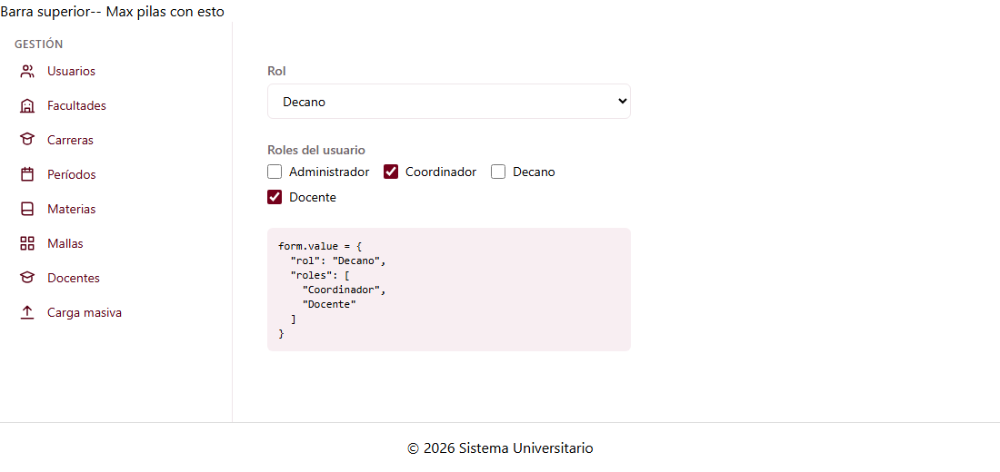

# Selector de rol (C1-13)

Guía para G1 y G5. Explica el selector de rol, que funciona con formularios reactivos, y los
servicios `RolService` y `PermisoService`, que también usa la matriz de roles y permisos (C1-12).

---

## 1. Qué es

Es una lista de los **roles activos** del sistema, con dos modos:

- **Simple** (por defecto): lista desplegable para elegir un rol.
- **Múltiple** (`[multiple]="true"`): casillas para elegir varios roles.

Funciona con **formularios reactivos** (`ControlValueAccessor`), como pide la hoja: se usa con
`formControlName` igual que un `<input>`.

| Dato                 | Valor                                         |
| -------------------- | --------------------------------------------- |
| ID                   | C1-13                                         |
| Selector             | `app-selector-rol`                            |
| Clase                | `SelectorRolComponent`                        |
| Tipo                 | Selector de dominio (no tiene ruta)           |
| Grupo dueño          | G1 · Gestión (Jose Luis Hidalgo)              |
| Carpeta              | `src/app/shared/components/selector-rol/`     |
| Datos                | `RolService.listar({ soloActivos: true })`    |

**Lo usan:** `app-usuarios-lista` (C1-10), `app-usuario-form` (C1-11) y `app-flujo-aprobacion-form` (G5).



---

## 2. Entradas, salidas y valor

| Tipo   | Nombre      | Valor por defecto | Descripción |
| ------ | ----------- | ----------------- | ----------- |
| Input  | `multiple`  | `false`           | Casillas para varios roles en lugar de lista desplegable. |
| Input  | `etiqueta`  | `'Rol'`           | Texto del label o la leyenda. **No está en la hoja.** |
| Output | `rolChange` | —                 | Emite el `Rol` completo (simple) o la lista `Rol[]` (múltiple) cuando el usuario cambia la selección. |

**Valor en el formulario:** el **nombre** del rol (`'Decano'`), o la lista de nombres en modo
múltiple (`['Coordinador', 'Docente']`). Se usa el nombre, y no el id, porque es único en la BD y
así coincide con `Usuario.roles` de `UsuarioService`: lo que sale del selector se guarda tal cual
en el usuario. En modo múltiple la lista sigue el orden de los roles, no el de los clics.

---

## 3. Cómo usarlo

```ts
import { ReactiveFormsModule } from '@angular/forms';
import { SelectorRolComponent } from '../../../shared/components/selector-rol/selector-rol';

@Component({ imports: [ReactiveFormsModule, SelectorRolComponent], /* ... */ })
```

**En el formulario de usuario (C1-11), varios roles:**
```ts
form = this.fb.group({
  // ...
  roles: this.fb.control<string[]>(usuario?.roles ?? [], Validators.required),
});
```
```html
<app-selector-rol formControlName="roles" [multiple]="true" etiqueta="Roles" />
```

**Sin formulario, por ejemplo un filtro en la lista de usuarios (C1-10):**
```html
<app-selector-rol (rolChange)="filtrarPorRol($event)" />
```

También funciona con `disable()` del formulario y marca el control como *tocado* al salir del campo.

---

## 4. `RolService` y `PermisoService` (compartidos)

Los creó Jose por acuerdo con Maximilian. **Decisión del equipo:** la hoja indica solo `RolService`
para C1-12, pero se **separaron en dos servicios para que sea escalable**. Si en el futuro se
pueden crear y editar permisos, eso irá en `PermisoService` sin tocar `RolService`. Hoy los
permisos son una lista fija (configuración predeterminada) y **solo se asignan a roles**.

### `RolService` (tabla `rol`)

| Método | Qué hace |
| ------ | -------- |
| `listar({ soloActivos? })` | Los 4 roles mínimos del documento |

| id | nombre | descripción |
| -- | ------ | ----------- |
| 1 | Administrador | Administrador del sistema |
| 2 | Coordinador | Coordinador de carrera |
| 3 | Decano | Decano / Aprobador |
| 4 | Docente | Docente |

El **nombre** corto es el que se guarda en los usuarios. El nombre largo del documento va en la descripción.

### `PermisoService` (tablas `permiso` y `rol_permiso`)

| Método | Qué hace |
| ------ | -------- |
| `listar()` | Todos los permisos: `codigo`, `nombre`, `descripcion` |
| `permisosDeRol(rolId)` | Códigos de permiso que tiene el rol |
| `asignarPermisos(rolId, codigos)` | Reemplaza los permisos del rol (lo que guarda la matriz). Rechaza códigos que no existen |

**Configuración predeterminada (TEMPORAL, a validar con el grupo):**

| Permiso | Administrador | Coordinador | Decano | Docente |
| ------- | :-: | :-: | :-: | :-: |
| `usuario.ver` | ✔ | | | |
| `facultad.ver` | ✔ | | ✔ | |
| `carrera.ver` | ✔ | ✔ | ✔ | |
| `periodo.ver` | ✔ | ✔ | | |
| `materia.ver` | ✔ | ✔ | | |
| `malla.ver` | ✔ | ✔ | | |
| `docente.ver` | ✔ | ✔ | | |
| `importacion.ejecutar` | ✔ | | | |

Los códigos son los que ya usa el menú de Gestión. Cada módulo (G2 a G5) deberá agregar los suyos.

---

## 5. Archivos

```
src/app/shared/
├── components/selector-rol/
│   ├── selector-rol.ts            ← clase (ControlValueAccessor)
│   ├── selector-rol.html          ← plantilla (Tailwind, tokens de la paleta)
│   └── selector-rol.spec.ts       ← 12 pruebas (incluye formulario reactivo real)
├── models/
│   ├── rol.model.ts
│   └── permiso.model.ts
└── services/
    ├── rol.service.ts             ← datos en memoria (TEMPORAL)
    ├── rol.service.spec.ts        ← 4 pruebas
    ├── permiso.service.ts         ← datos en memoria (TEMPORAL)
    └── permiso.service.spec.ts    ← 7 pruebas
```

---

## 6. Pruebas

- **Selector, sin formulario:** lista los 4 roles, el label está asociado, emite el rol en modo
  simple y la lista en modo múltiple (en el orden de los roles).
- **Selector, con formulario reactivo:** muestra el valor inicial, actualiza el control con el
  nombre o la lista de nombres, refleja los cambios que hace el formulario, pide elegir si el valor
  es `null`, se marca como tocado y se deshabilita con el formulario.
- **Error:** si el servicio falla, muestra el aviso y deshabilita la lista.
- **Servicios:**
  - `RolService`: los 4 roles con sus descripciones, el filtro por activos y que devuelva copias.
  - `PermisoService`: los permisos del menú, códigos únicos, la configuración predeterminada, la asignación sin repetidos, el rechazo de códigos desconocidos y que devuelva copias.

Ejecutar: `npm test`.

---

## 7. Advertencias

| Tema | Detalle |
| ---- | ------- |
| **Sin opción "Todos"** | La hoja no la pide. Para un filtro que se pueda limpiar, usa el modo múltiple (sin casillas marcadas = todos) o pide que se agregue una entrada, como `permitirTodas` en C1-22. |
| **Permisos provisionales** | Los códigos y la configuración predeterminada son una propuesta. Hay que acordarlos con el grupo y con los demás módulos. |
| **El menú todavía no usa `PermisoService`** | Hoy los permisos del usuario se cargan a mano en `app.config.ts` (`PermisosService.establecer`). Cuando exista el login, deberían salir de los roles del usuario y de `PermisoService`. |
