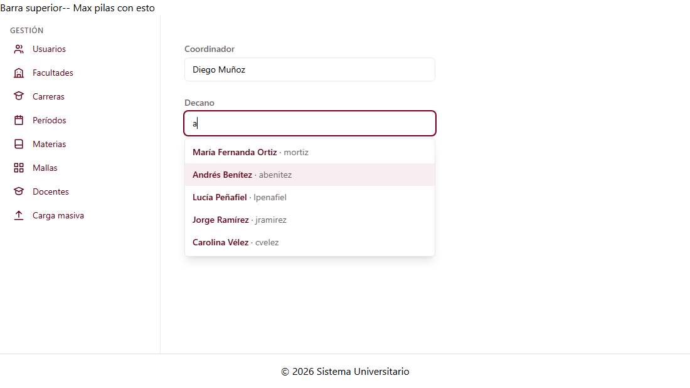

# Selector de usuario (C1-14)

Guía para G1 y G5. Explica el autocompletar de usuarios y el `UsuarioService`, que también
usan las pantallas de usuarios (C1-10 y C1-11).

---

## 1. Qué es

Es un campo de texto que, mientras escribes, sugiere usuarios **activos** por **nombres** o
**username**, sin distinguir tildes ni mayúsculas. Se puede filtrar por rol, por ejemplo para
mostrar solo decanos o solo coordinadores.

| Dato                 | Valor                                            |
| -------------------- | ------------------------------------------------ |
| ID                   | C1-14                                            |
| Selector             | `app-selector-usuario`                           |
| Clase                | `SelectorUsuarioComponent`                       |
| Tipo                 | Selector de dominio (no tiene ruta)              |
| Grupo dueño          | G1 · Gestión (Jose Luis Hidalgo)                 |
| Carpeta              | `src/app/shared/components/selector-usuario/`    |
| Datos                | `UsuarioService.listar({ rol, soloActivos: true })` |

**Lo usan:** `app-facultad-form` (C1-21), `app-carrera-form` (C1-24), `app-docente-form` y
`app-bandeja-aprobacion` (G5).



---

## 2. Entradas y salidas

| Tipo   | Nombre          | Valor por defecto | Descripción |
| ------ | --------------- | ----------------- | ----------- |
| Input  | `rol`           | —                 | Muestra solo usuarios con ese rol: `'Administrador'`, `'Coordinador'`, `'Decano'` o `'Docente'`. |
| Input  | `usuarioId`     | `null`            | Usuario que aparece elegido al inicio, por ejemplo el decano actual al editar una facultad. **No está en la hoja**: se agregó por la misma razón que `facultadId` en C1-22. |
| Input  | `etiqueta`      | `'Usuario'`       | Texto del label, por ejemplo "Decano". **No está en la hoja.** |
| Output | `usuarioChange` | —                 | Emite el `Usuario` completo cuando el usuario elige uno. |

- **Solo emite cuando el usuario elige**, no al cargar ni con `usuarioId`.
- Si el usuario escribe algo y sale del campo sin elegir, el campo vuelve a mostrar el usuario
  que estaba elegido.

---

## 3. Cómo usarlo

```ts
import { SelectorUsuarioComponent } from '../../../shared/components/selector-usuario/selector-usuario';
import { Usuario } from '../../../shared/models/usuario.model';

@Component({ imports: [SelectorUsuarioComponent], /* ... */ })
```

**En el formulario de facultad (C1-21):**
```html
<app-selector-usuario
  etiqueta="Decano"
  rol="Decano"
  [usuarioId]="facultad()?.decanoUsuarioId ?? null"
  (usuarioChange)="decano = $event"
/>
```
Al guardar, `decanoUsuarioId = decano.id` y `decanoNombre = decano.nombres`.

**Como filtro en G5:**
```html
<app-selector-usuario etiqueta="Solicitante" (usuarioChange)="filtrarPorUsuario($event)" />
```

---

## 4. Teclado y accesibilidad

| Tecla | Qué hace |
| ----- | -------- |
| Escribir | Abre la lista y filtra |
| ↓ / ↑ | Se mueve entre las sugerencias |
| Enter | Elige la sugerencia resaltada |
| Escape | Cierra la lista sin elegir |

Sigue el patrón *combobox* de WAI-ARIA: `role="combobox"`, `aria-expanded`, `aria-controls`,
`aria-activedescendant`, y la lista con `role="listbox"` y `role="option"`. Muestra como
máximo 8 sugerencias.

---

## 5. `UsuarioService` (compartido)

Lo creó Jose por acuerdo con Maximilian. Lo usan C1-14 y las pantallas de usuarios de
Maximilian (C1-10 lista y C1-11 formulario). **Modelo** `src/app/shared/models/usuario.model.ts`,
según la tabla `usuario`:

| Campo        | BD                                     |
| ------------ | -------------------------------------- |
| `id`         | `id`                                   |
| `username`   | `username` UK                          |
| `email`      | `email` UK                             |
| `nombres`    | `nombres`                              |
| `origen`     | `origen` CHECK `LOCAL` o `SIAC`        |
| `codigoSiac` | `codigo_siac` UK, nullable             |
| `estado`     | `estado` CHECK `A` o `I`               |
| `roles`      | *No está en la tabla*: nombres de sus roles (`usuario_rol`), que la API devolverá unidos |

`password_hash` **no** está en el modelo, porque nunca debe llegar al front. `DatosUsuario` es
el mismo modelo sin `id`.

| Método | Qué hace |
| ------ | -------- |
| `listar({ rol?, soloActivos? })` | Lista usuarios, filtrando por rol y/o solo activos |
| `crear(datos)` | Crea un usuario y lo devuelve con su `id` |
| `actualizar(id, datos)` | Reemplaza los datos de un usuario |
| `cambiarEstado(id, 'A' \| 'I')` | Activa o desactiva |

Todos devuelven `Observable` y entregan copias. Si se repite un **username**, un **email** o un
**código SIAC** (reglas UK de la BD), o si faltan campos obligatorios, responden con un error que
trae su mensaje.

**TEMPORAL:** 10 usuarios ficticios en memoria. Los decanos con id 10 a 13 son los mismos de
`FacultadService`. Hay un decano libre (Carolina Vélez, id 14) para probar la asignación y un
docente inactivo para probar el filtro.

---

## 6. Archivos

```
src/app/shared/
├── components/selector-usuario/
│   ├── selector-usuario.ts          ← clase
│   ├── selector-usuario.html        ← plantilla (Tailwind, tokens de la paleta)
│   └── selector-usuario.spec.ts     ← 15 pruebas
├── models/usuario.model.ts          ← Usuario, DatosUsuario
└── services/
    ├── usuario.service.ts           ← datos en memoria (TEMPORAL)
    └── usuario.service.spec.ts      ← 10 pruebas
```

---

## 7. Pruebas

- **Selector:**
  - el label está asociado al campo y la lista empieza cerrada;
  - sugiere por nombre sin distinguir tildes ni mayúsculas, y también por username;
  - filtra por rol, no muestra inactivos y muestra como máximo 8 sugerencias;
  - se puede elegir con el mouse o con el teclado (flechas, Enter), y Escape cierra sin elegir;
  - al salir del campo vuelve a mostrar el usuario elegido;
  - preselecciona `usuarioId` sin emitir y lo sigue si el padre lo cambia;
  - cada selector tiene ids distintos y, si el servicio falla, muestra el error.
- **Servicio:** filtros por rol y por activos, que devuelva copias, crear, las tres reglas de
  unicidad, campos obligatorios, actualizar y cambiar estado.

Ejecutar: `npm test`.

---

## 8. Advertencias

| Tema | Detalle |
| ---- | ------- |
| **Los nombres de rol son texto** | Son `'Administrador'`, `'Coordinador'`, `'Decano'` y `'Docente'`, los mismos `nombre` de `RolService` (ver la guía de C1-13). El selector de rol entrega esos nombres, así que se guardan tal cual en `Usuario.roles`. |
| **Solo usuarios activos** | La hoja no lo dice. Se decidió así porque no tiene sentido asignar un decano o coordinador inactivo. Si G5 necesita filtrar por usuarios inactivos (historial), se puede agregar una entrada. |
| **No es control de formulario** | No funciona con `formControlName`. Si el formulario reactivo de Maximilian lo necesita así, se agrega después. |
