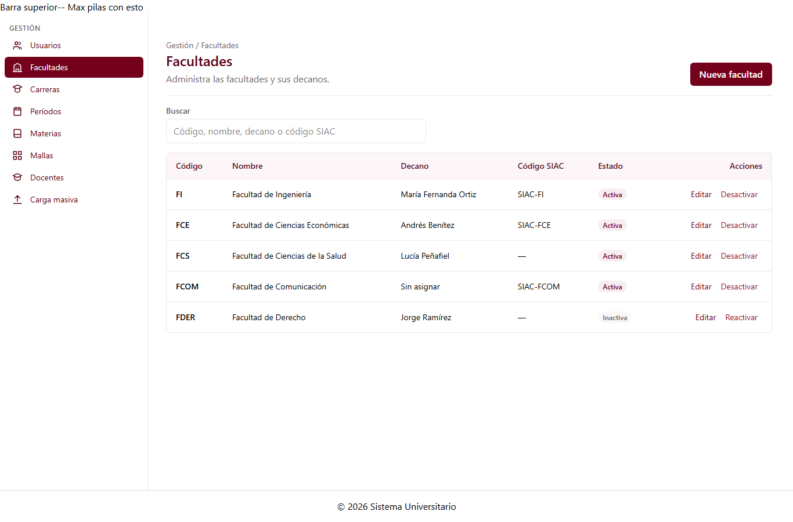

# Listado de facultades (C1-20)

Guía para el equipo. Explica qué hace la página, qué piezas son provisionales y cómo
reemplazarlas cuando los otros grupos entreguen sus componentes.

---

## 1. Qué es

Página con el listado de facultades, búsqueda y acciones **crear**, **editar**,
**desactivar** y **reactivar**.

| Dato                 | Valor                                             |
| -------------------- | ------------------------------------------------- |
| ID                   | C1-20                                             |
| Selector             | `app-facultades-lista`                            |
| Clase                | `FacultadesListaComponent`                        |
| Tipo                 | Página (tiene ruta propia)                        |
| **Ruta**             | **`/gestion/facultades`**                         |
| Grupo dueño          | G1 · Gestión (Jose Luis Hidalgo)                  |
| Carpeta              | `src/app/features/gestion/facultades-lista/`      |
| `@Input` / `@Output` | Ninguno                                           |
| Datos                | `FacultadService`                                 |

Lo que ve el usuario:

- La tabla con código, nombre, decano, código SIAC, estado y acciones.
- Un buscador que no distingue tildes ni mayúsculas. Busca en código, nombre, decano y código SIAC.
- Mensajes para cuando la página está cargando, cuando hay un error (con botón **Reintentar**) y cuando la lista o la búsqueda quedan vacías.
- Una confirmación antes de desactivar o reactivar una facultad.
- Un aviso después de cada acción, que los lectores de pantalla también leen (`aria-live`).



---

## 2. Modelo y servicio (compartidos)

Los usan C1-20, C1-21 (formulario) y C1-22 (selector de facultad).

**`src/app/shared/models/facultad.model.ts`**, que sigue la tabla `facultad` del diagrama de BD:

| Campo            | Tipo              | BD                                        |
| ---------------- | ----------------- | ----------------------------------------- |
| `id`             | `number`          | `id` PK                                   |
| `codigo`         | `string`          | `codigo` UK, NOT NULL                     |
| `nombre`         | `string`          | `nombre` NOT NULL                         |
| `decanoUsuarioId`| `number \| null`  | `decano_usuario_id` FK, UK, nullable      |
| `decanoNombre`   | `string \| null`  | *No está en la tabla*: nombre del decano que devolverá la API |
| `codigoSiac`     | `string \| null`  | `codigo_siac` UK, nullable                |
| `estado`         | `'A' \| 'I'`      | `estado` CHECK A o I                      |

`DatosFacultad` es el mismo modelo sin `id`, y se usa para crear o editar.

**`src/app/shared/services/facultad.service.ts`** (TEMPORAL: tiene datos en memoria).
Las 5 facultades y sus decanos son **ficticios**, solo para el prototipo, como pide el documento
de planificación: "los servicios devuelven datos de prueba (mock) con la misma forma que tendrá
la API". Cuando exista el backend se borran y el servicio llama a la API.

| Método | Qué hace |
| ------ | -------- |
| `listar({ soloActivas? })` | Devuelve todas las facultades, o solo las activas con `soloActivas: true` (para el selector C1-22). |
| `crear(datos)` | Crea una facultad y la devuelve con su `id`. |
| `actualizar(id, datos)` | Reemplaza los datos de una facultad. |
| `cambiarEstado(id, 'A' \| 'I')` | Desactiva o reactiva una facultad. |

Todos devuelven `Observable`, y cada resultado es una copia, así que modificarlo no altera los datos guardados.
Si se rompe una regla de unicidad de la BD, responden con un error que trae su mensaje:

- un **código** repetido (sin distinguir mayúsculas);
- un **código SIAC** repetido (puede haber varias facultades sin código);
- un **decano** que ya dirige otra facultad.

Cuando exista la API, solo cambia el interior de cada método por la llamada HTTP.

---

## 3. Piezas provisionales (TEMPORAL)

Ninguno de los componentes hijos existe todavía. Cada pieza está marcada en el código con
`TEMPORAL` … `FIN TEMPORAL`.

| Pieza provisional | Reemplazar por | Cómo |
| ----------------- | -------------- | ---- |
| Encabezado (título, migas y botón **Nueva facultad**) | `app-encabezado-pagina` (C3-23, G3) | Pasar el título y el subtítulo, y poner el botón en su zona de acciones. |
| Tabla | `app-tabla-datos` (C4-20, G4) | Configurar las columnas. El estado va como badge y las acciones, como plantilla. |
| Etiqueta Activa/Inactiva | `app-estado-badge` (C5-08, G5) | Traducir `A` a `ACTIVO` e `I` a `INACTIVO`. |
| Panel "Aquí irá el formulario" | `app-facultad-form` (C1-21, Maximilian) | Ver la sección 3.1. |
| Ventana de confirmación | `ConfirmacionService.abrir()` de `app-dialogo-confirmacion` (C2-24, G2) | Ver la sección 3.2. |

### 3.1 Integrar el formulario (C1-21)

La página ya tiene listos los dos métodos públicos que pide el contrato de C1-21
(`facultad?: Facultad`, salidas `guardar` y `cancelar`). Basta con cambiar el panel del HTML por:

```html
<app-facultad-form
  [facultad]="enFormulario() ?? undefined"
  (guardar)="alGuardar($event)"
  (cancelar)="cerrarForm()"
/>
```

y agregar `FacultadFormComponent` a `imports`.

- Si `facultad` llega vacío, el formulario es para **crear**; si llega con datos, es para **editar**.
- `alGuardar` espera un `DatosFacultad`, es decir, la facultad sin `id`. Si el formulario
  emite otra cosa, hay que ponerse de acuerdo con Maximilian.
- Si el servicio rechaza los datos (por ejemplo, un código repetido), el formulario sigue
  abierto y el error aparece como aviso.

### 3.2 Integrar la confirmación (C2-24)

La confirmación provisional usa **la misma firma** que `ConfirmacionService.abrir()`, que
recibe `{ titulo, mensaje, textoConfirmar?, textoCancelar?, peligro? }` y devuelve
`Promise<boolean>`. Al integrar:

1. Inyectar `ConfirmacionService`.
2. Hacer que `confirmar()` devuelva `this.confirmacion.abrir(opciones)`.
3. Borrar la señal `confirmacion`, el método `responder` y el bloque del diálogo en el HTML.

---

## 4. Ruta

Está declarada en `src/app/app.routes.ts` como hija de `ShellLayout` y se carga de forma diferida:

```ts
{
  path: 'gestion/facultades',
  loadComponent: () =>
    import('./features/gestion/facultades-lista/facultades-lista').then(
      (m) => m.FacultadesListaComponent,
    ),
},
```

La opción **Facultades** del menú lateral (`gestion.menu.ts`, permiso `facultad.ver`) ya apunta a esta ruta.

---

## 5. Archivos

```
src/app/
├── app.routes.ts                                   ← ruta /gestion/facultades
├── features/gestion/facultades-lista/
│   ├── facultades-lista.ts                         ← clase del componente
│   ├── facultades-lista.html                       ← plantilla (Tailwind, tokens de la paleta)
│   └── facultades-lista.spec.ts                    ← 18 pruebas
└── shared/
    ├── models/facultad.model.ts                    ← Facultad, DatosFacultad, EstadoFacultad
    └── services/
        ├── facultad.service.ts                     ← datos en memoria (TEMPORAL)
        └── facultad.service.spec.ts                ← 12 pruebas
```

---

## 6. Pruebas

`facultades-lista.spec.ts` verifica que:

- se muestran el título y las 5 facultades de prueba, con `A`/`I` como Activa/Inactiva y "Sin asignar" cuando no hay decano;
- la búsqueda no distingue tildes ni mayúsculas, busca por decano y por código SIAC, y avisa cuando no encuentra nada;
- hay caption en la tabla, label en el buscador y `aria-label` con el nombre en cada acción;
- al cancelar la confirmación no cambia nada; al confirmar, desactiva o reactiva y muestra un aviso;
- **Nueva facultad** y **Editar** abren el panel del formulario, y **Cancelar** lo cierra;
- `alGuardar` crea o actualiza según el caso, y si hay un error (código repetido) el formulario queda abierto;
- si falla la carga se muestra el error, y **Reintentar** vuelve a cargar;
- la ruta `/gestion/facultades` muestra la página.

`facultad.service.spec.ts` verifica el filtro `soloActivas`, que se devuelvan copias, las tres reglas de unicidad,
los campos obligatorios, la actualización y el cambio de estado.

Ejecutar: `npm test`.

---

## 7. Probarlo a mano

1. Corre `npm start`.
2. Abre `http://localhost:4200/gestion/facultades`, o entra por **Gestión → Facultades** en el menú.
3. Escribe "ingenieria" (sin tilde) en el buscador: debe aparecer la Facultad de Ingeniería.
4. Pulsa **Desactivar** en una fila, confirma y revisa que la etiqueta cambie a *Inactiva*.

---

## 8. Advertencias y pendientes

| Tema | Detalle |
| ---- | ------- |
| **Los datos no se guardan** | Al recargar la página se vuelve a los 5 datos de prueba. |
| **Crear y editar todavía no funcionan en pantalla** | El panel solo indica dónde irá el formulario C1-21. La lógica de guardado sí está lista y probada (`alGuardar`). |
| **Reactivar** | La hoja solo habla de "desactivar". Se agregó reactivar porque el estado es `A`/`I` y sin esa opción no habría forma de volver atrás. |
| **Desactivar con carreras activas** | La documentación no dice qué hacer en ese caso. Hay que definirlo con el grupo y con el backend. |
| **Permisos** | La página no revisa `facultad.ver`; solo lo hace el menú. Cuando exista el guard (ver la guía de C1-07), hay que agregarlo a la ruta. |
