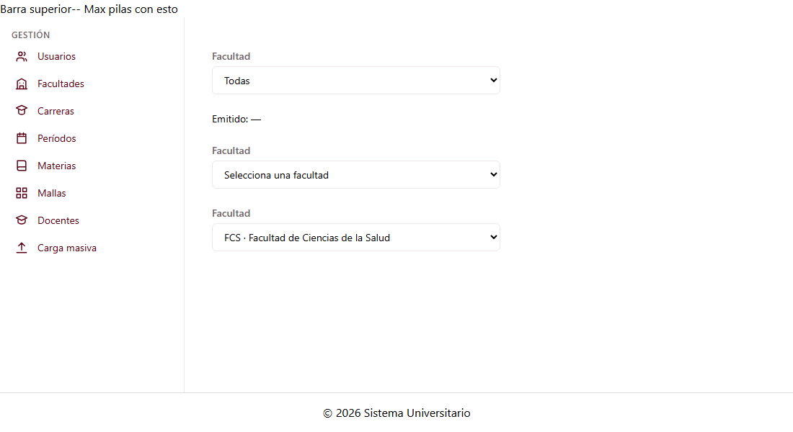

# Selector de facultad (C1-22)

Guía para los grupos G1, G2, G3 y G5. Explica qué hace el selector y cómo usarlo en tus pantallas.

---

## 1. Qué es

Es una lista desplegable con las **facultades activas** (estado `A`). Sirve para dos cosas:

- **Filtrar** (con `permitirTodas`): la primera opción es **Todas**, que emite `null`.
- **Elegir una facultad obligatoria** en un formulario (sin `permitirTodas`): la primera
  opción es "Selecciona una facultad" y no se puede volver a elegir.

| Dato                 | Valor                                          |
| -------------------- | ---------------------------------------------- |
| ID                   | C1-22                                          |
| Selector             | `app-selector-facultad`                        |
| Clase                | `SelectorFacultadComponent`                    |
| Tipo                 | Selector de dominio (no tiene ruta)            |
| Grupo dueño          | G1 · Gestión (Jose Luis Hidalgo)               |
| Carpeta              | `src/app/shared/components/selector-facultad/` |
| Datos                | `FacultadService.listar({ soloActivas: true })`|



---

## 2. Entradas y salidas

| Tipo   | Nombre           | Valor por defecto | Descripción |
| ------ | ---------------- | ----------------- | ----------- |
| Input  | `permitirTodas`  | `false`           | Agrega la opción **Todas**. |
| Input  | `facultadId`     | `null`            | Facultad que aparece elegida al inicio, por ejemplo al editar una carrera. **No está en la hoja**: se agregó porque, sin ella, el formulario de carrera no podría mostrar la facultad actual. |
| Output | `facultadChange` | —                 | Emite la `Facultad` completa que eligió el usuario, o `null` si eligió **Todas**. |

- **Solo emite cuando el usuario cambia la selección**, no al cargar. Así que, si usas
  `facultadId`, ese valor ya lo conoces tú.
- Si `facultadId` corresponde a una facultad **inactiva**, no aparece en la lista y el
  selector queda sin elegir.

---

## 3. Cómo usarlo

Importa el componente:

```ts
import { SelectorFacultadComponent } from '../../../shared/components/selector-facultad/selector-facultad';
import { Facultad } from '../../../shared/models/facultad.model';

@Component({
  imports: [SelectorFacultadComponent],
  // ...
})
```

(Ajusta la ruta del `import` según dónde esté tu componente.)

### 3.1 Como filtro (G2 planificaciones, G5 bandeja y reportes)

```html
<app-selector-facultad [permitirTodas]="true" (facultadChange)="filtrarPorFacultad($event)" />
```

```ts
protected readonly facultad = signal<Facultad | null>(null);

filtrarPorFacultad(f: Facultad | null) {
  this.facultad.set(f);   // null = todas
}
```

### 3.2 En un formulario (G1 carrera-form, G3 prioridades de espacio)

```html
<app-selector-facultad [facultadId]="carrera?.facultadId ?? null" (facultadChange)="facultadId = $event?.id ?? null" />
```

Validar que haya una facultad elegida (es obligatoria para una carrera) le toca a tu formulario.

---

## 4. Archivos

```
src/app/shared/components/selector-facultad/
├── selector-facultad.ts         ← clase del componente
├── selector-facultad.html       ← plantilla (Tailwind, tokens de la paleta)
└── selector-facultad.spec.ts    ← 12 pruebas
```

El modelo `Facultad` y el `FacultadService` son los mismos de C1-20 (ver su guía, sección 2).
El servicio todavía usa datos de prueba (TEMPORAL).

---

## 5. Pruebas

`selector-facultad.spec.ts` verifica que:

- solo aparecen facultades activas;
- sin `permitirTodas` pide elegir una facultad, y con `permitirTodas` aparece **Todas** ya elegida;
- emite la facultad completa al elegirla, `null` al elegir **Todas**, y nada al cargar;
- `facultadId` preselecciona la facultad, se ignora si es de una inactiva y se actualiza si el padre lo cambia;
- el label está asociado al select y cada selector tiene un id distinto;
- si el servicio falla, se muestra un error y el selector queda deshabilitado.

Ejecutar: `npm test`.

---

## 6. Advertencias

| Tema | Detalle |
| ---- | ------- |
| **No es un control de formulario** | No funciona con `formControlName` ni con `ngModel`, porque la hoja solo pide input y output. Si un formulario reactivo lo necesita así, se puede agregar después. |
| **No se actualiza solo** | Carga las facultades una vez, al crearse. Si en la misma pantalla se crea o se desactiva una facultad, el selector no lo ve hasta que se vuelva a crear. |
