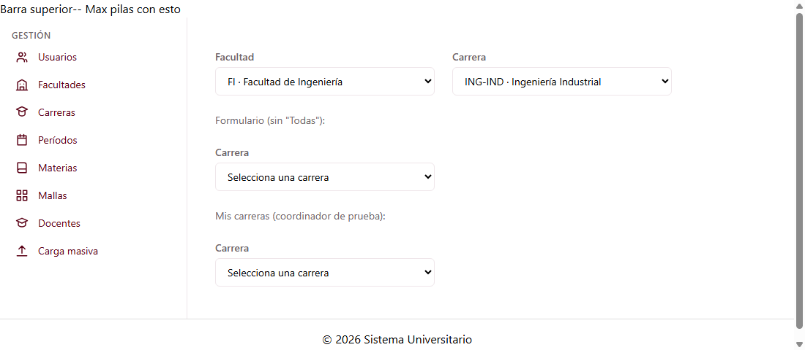

# Selector de carrera (C1-25)

Guía para G1, G2, G3 y G5. Explica el selector de carrera y el `CarreraService`, que también
usan las pantallas de carreras (C1-23 y C1-24).

---

## 1. Qué es

Es una lista desplegable con las **carreras activas**. Se puede:

- **filtrar por facultad** (`facultadId`);
- **limitar a "mis carreras"** (`soloMias`): solo la carrera que coordina el usuario actual;
- agregar la opción **Todas** (`permitirTodas`), para usarlo como filtro.

| Dato                 | Valor                                          |
| -------------------- | ---------------------------------------------- |
| ID                   | C1-25                                          |
| Selector             | `app-selector-carrera`                         |
| Clase                | `SelectorCarreraComponent`                     |
| Tipo                 | Selector de dominio (no tiene ruta)            |
| Grupo dueño          | G1 · Gestión (Jose Luis Hidalgo)               |
| Carpeta              | `src/app/shared/components/selector-carrera/`  |
| Datos                | `CarreraService.listar({ facultadId, coordinadorUsuarioId, soloActivas: true })` |

**Lo usan:** `app-materias-lista`, `app-materia-form`, `app-mallas-lista` (G1);
`app-planificaciones-lista`, `app-planificacion-nueva`, `app-historial-planificaciones` (G2);
`app-vista-horario` (G3) y `app-filtros-reporte` (G5).



---

## 2. Entradas y salidas

| Tipo   | Nombre          | Por defecto | Descripción |
| ------ | --------------- | ----------- | ----------- |
| Input  | `facultadId`    | `null`      | Solo carreras de esa facultad. Si cambia, la lista se vuelve a filtrar. |
| Input  | `soloMias`      | `false`     | Solo la carrera que coordina el usuario actual. |
| Input  | `permitirTodas` | `false`     | Agrega **Todas**, que emite `null`. **No está en la hoja**: casi todos sus padres son filtros (lista de materias, planificaciones, reportes) y necesitan poder elegir "todas". Igual que en C1-22. |
| Input  | `carreraId`     | `null`      | Carrera preseleccionada (por ejemplo, al editar una materia). **No está en la hoja**, igual que `facultadId` en C1-22. |
| Output | `carreraChange` | —           | Emite la `Carrera` elegida, o `null` si se elige **Todas**. |

- Solo emite cuando el usuario cambia la selección, no al cargar.
- Si cambia la facultad y la carrera elegida ya no es de esa facultad, se deselecciona. Con
  `permitirTodas`, además emite `null` para que el filtro del padre no quede desactualizado.

---

## 3. Cómo usarlo

```ts
import { SelectorCarreraComponent } from '../../../shared/components/selector-carrera/selector-carrera';
import { Carrera } from '../../../shared/models/carrera.model';

@Component({ imports: [SelectorCarreraComponent], /* ... */ })
```

**Como filtro, junto al selector de facultad (G2, G5, lista de materias):**
```html
<app-selector-facultad [permitirTodas]="true" (facultadChange)="facultadId.set($event?.id ?? null)" />
<app-selector-carrera [permitirTodas]="true" [facultadId]="facultadId()" (carreraChange)="carrera.set($event)" />
```

**En un formulario (por ejemplo, la carrera responsable de una materia):**
```html
<app-selector-carrera [carreraId]="materia?.carreraResponsableId ?? null" (carreraChange)="carreraId = $event?.id ?? null" />
```

**Coordinador que solo ve su carrera (G2, nueva planificación):**
```html
<app-selector-carrera [soloMias]="true" (carreraChange)="carrera.set($event)" />
```

---

## 4. `CarreraService` (compartido)

Lo creó Jose por acuerdo con Maximilian. Lo usan C1-25 y las pantallas de carreras de
Maximilian (C1-23 lista y C1-24 formulario). **Modelo** `src/app/shared/models/carrera.model.ts`,
según la tabla `carrera`:

| Campo                  | BD                                                  |
| ---------------------- | --------------------------------------------------- |
| `id`                   | `id`                                                |
| `codigo`               | `codigo` UK                                         |
| `nombre`               | `nombre`                                            |
| `facultadId`           | `facultad_id` FK **obligatoria**                    |
| `facultadNombre`       | *No está en la tabla*: nombre de la facultad unido por la API |
| `jornada`              | CHECK `MATUTINA`, `VESPERTINA` o `NOCTURNA`         |
| `modalidad`            | CHECK `PRESENCIAL` o `VIRTUAL`                      |
| `coordinadorUsuarioId` | `coordinador_usuario_id` FK, UK, nullable           |
| `coordinadorNombre`    | *No está en la tabla*: nombre del coordinador unido por la API |
| `codigoSiac`           | `codigo_siac` UK, nullable                          |
| `estado`               | CHECK `A` o `I`                                     |

| Método | Qué hace |
| ------ | -------- |
| `listar({ facultadId?, coordinadorUsuarioId?, soloActivas? })` | Lista con filtros |
| `crear(datos)` | Crea una carrera y la devuelve con su `id` |
| `actualizar(id, datos)` | Reemplaza los datos |
| `cambiarEstado(id, 'A' \| 'I')` | Activa o desactiva |

Rechaza (con un mensaje de error) lo que prohíbe la BD:
- una carrera **sin facultad** (el documento lo exige: "no debe permitirse crear o editar una carrera sin asignarle una facultad");
- un **código** o **código SIAC** repetido;
- un **coordinador** que ya coordina otra carrera.

**TEMPORAL:** 7 carreras ficticias en memoria.
- Las carreras 5, 6 y 7 (ING-COMP, ING-IND, ARQ) son las mismas de las materias de prueba de Julio. Los códigos ING-COMP e ING-IND son los del ejemplo del Anexo B.
- Las facultades son las de `FacultadService` y los coordinadores (Diego Muñoz, id 20, y Paola Acosta, id 21) los de `UsuarioService`.
- Derecho (id 4) está inactiva, igual que su facultad.

---

## 5. Archivos

```
src/app/shared/
├── components/selector-carrera/
│   ├── selector-carrera.ts          ← clase
│   ├── selector-carrera.html        ← plantilla (Tailwind, tokens de la paleta)
│   └── selector-carrera.spec.ts     ← 12 pruebas
├── models/carrera.model.ts          ← Carrera, DatosCarrera
└── services/
    ├── carrera.service.ts           ← datos en memoria (TEMPORAL)
    └── carrera.service.spec.ts      ← 13 pruebas
```

---

## 6. Pruebas

- **Selector:**
  - solo muestra carreras activas;
  - sin `permitirTodas` pide elegir una; con `permitirTodas` muestra "Todas" y la emite como `null`;
  - emite la carrera completa al elegirla;
  - filtra por facultad, se vuelve a filtrar si la facultad cambia y deselecciona la carrera que ya no corresponde;
  - `soloMias` muestra solo la carrera del coordinador de prueba y avisa si no coordina ninguna;
  - preselecciona `carreraId` sin emitir;
  - el label está asociado, los ids no se repiten y, si el servicio falla, muestra el error.
- **Servicio:**
  - las carreras de las materias de Julio existen con el mismo nombre;
  - filtros por facultad, coordinador y activas, y que devuelva copias;
  - crear; rechazar una carrera sin facultad, los códigos o coordinadores repetidos y los campos vacíos;
  - actualizar y cambiar estado.

Ejecutar: `npm test`.

---

## 7. Advertencias

| Tema | Detalle |
| ---- | ------- |
| **"Mis carreras" usa un usuario de prueba** | Todavía no existe el login (C1-05, Maximilian). `soloMias` usa el usuario 20 (Diego Muñoz, coordinador de ING-COMP), marcado como TEMPORAL en `selector-carrera.ts`. Cuando exista la sesión, se reemplaza por el usuario real. |
| **Un coordinador, una carrera** | La BD hace único a `coordinador_usuario_id`, así que "mis carreras" devuelve como máximo una. Si el cliente quiere coordinadores de varias carreras, hay que cambiar el modelo de datos. |
| **No es control de formulario** | No funciona con `formControlName` (la hoja no lo pide para C1-25). Si un formulario reactivo lo necesita así, se puede agregar como en C1-13. |
