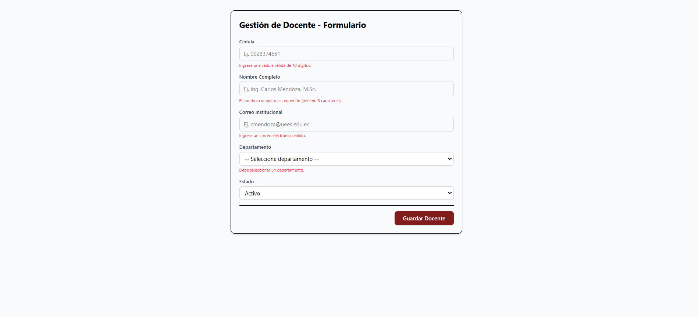

# Componente: Formulario de Docente (app-docente-form) - C1-41

Componente frontend standalone exclusivo del grupo desarrollado bajo la arquitectura `features`, diseñado para la creación y edición de registros de docentes mediante formularios reactivos de Angular.

## Funcionalidades
- **Formulario Reactivo:** Validación en tiempo real para cédula (10 dígitos), nombre completo, correo institucional, departamento y estado.
- **Validaciones de Entrada:** Control visual de errores para campos obligatorios o formatos incorrectos.
- **Acción de Guardado:** Permite procesar el registro con retroalimentación en consola y restablecimiento del formulario.

## Estructura y Ubicación
- **Ruta del Componente:** `src/app/features/gestion/app-docente-form/`
- **Clase Principal:** `DocenteFormComponent`
- **Selector:** `app-docente-form`

## Captura de Pantalla
