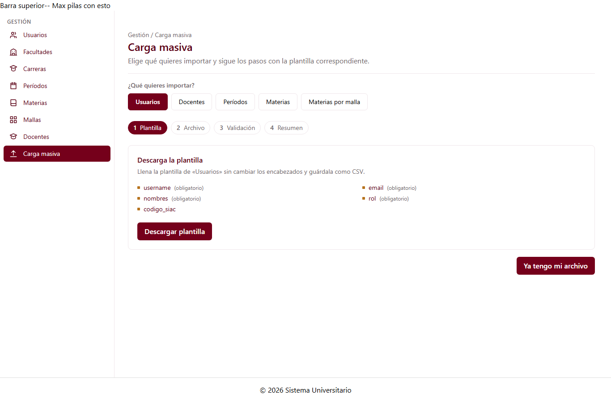

# Página de carga masiva (C1-55)

Guía para el equipo. Explica la página de carga masiva del módulo Gestión y sus 5 plantillas.

> **Autoría:** Julio armó la primera versión junto con su asistente C1-50. Jose Luis la completó
> con el selector de entidad y las plantillas del Anexo C. Guías relacionadas:
> `C1-50-carga-masiva.md` (asistente), `C1-54-resumen-importacion.md` (paso 4) y
> `C1-56-bitacora-importaciones.md` (historial).

---

## 1. Qué es

| Dato                 | Valor                                            |
| -------------------- | ------------------------------------------------ |
| ID                   | C1-55                                            |
| Selector             | `app-carga-masiva-pagina`                        |
| Clase                | `CargaMasivaPaginaComponent`                     |
| Tipo                 | Página                                           |
| **Ruta**             | **`/gestion/carga-masiva`**                      |
| Grupo dueño          | G1 · Gestión (Jose Luis Hidalgo)                 |
| Carpeta              | `src/app/features/gestion/carga-masiva-pagina/`  |
| `@Input` / `@Output` | Ninguno                                          |

El usuario elige **qué importar** (Usuarios, Docentes, Períodos, Materias o Materias por malla)
y debajo aparece el asistente de Julio (C1-50) con la plantilla de esa entidad. Si cambia de
entidad a mitad del proceso, el asistente **vuelve a empezar** para no mezclar archivos de
plantillas distintas. El botón **Ver bitácora** del encabezado lleva a C1-56.



---

## 2. Las 5 plantillas (Anexo C)

Están en `carga-masiva-pagina/plantillas-gestion.ts`. Los encabezados del CSV son exactamente
los nombres del anexo, y los marcados con * son obligatorios.

| Entidad | Columnas | Validaciones extra |
| ------- | -------- | ------------------ |
| Usuarios | username\*, email\*, nombres\*, rol\*, codigo_siac | `email` con formato de correo |
| Docentes | identificacion\*, nombres\*, email\*, carga_maxima_horas\*, codigo_siac, materias_habilitadas | `email`; `carga_maxima_horas` debe ser un número mayor que 0 |
| Períodos | codigo\*, nombre\*, tipo\*, fecha_inicio\*, fecha_fin\*, codigo_siac | `tipo` debe ser ORDINARIO o EXTRAORDINARIO; las fechas van como AAAA-MM-DD y deben existir; `fecha_fin` tiene que ser posterior a `fecha_inicio` (regla de la BD) |
| Materias | codigo\*, nombre\*, descripcion, carrera_responsable\*, codigo_siac | — (la materia **no** lleva créditos ni horas, porque dependen de la malla) |
| Materias por malla | malla\*, materia\*, nivel\*, unidad_curricular\*, horas_contacto\*, horas_practico\*, horas_autonomas\*, prerrequisitos, correquisitos | `nivel` debe ser un entero mayor que 0; `unidad_curricular` debe ser BASICA, PROFESIONAL o INTEGRACION; las horas deben ser números (0 o más) |

Cada plantilla es un `PlantillaCarga` (modelo de Julio). Para agregar una columna o una validación
se edita solo ese archivo; la página y el asistente no cambian.

---

## 3. Piezas provisionales (TEMPORAL)

| Pieza | Reemplazar por | Dónde |
| ----- | -------------- | ----- |
| Encabezado de la página y botón **Ver bitácora** | `app-encabezado-pagina` (C3-23, G3) | `carga-masiva-pagina.html` |
| `endpoint` de cada plantilla | La ruta real del backend | `plantillas-gestion.ts` |

Las piezas provisionales del asistente (subir archivo, tarjetas del resumen) están en las guías
de C1-50 y C1-54.

---

## 4. Diferencias con la hoja de componentes

| Hoja | Implementación | Motivo |
| ---- | -------------- | ------ |
| Validar que `rol` exista | Solo se valida que no esté vacío | Los nombres de rol los definirá `RolService` (C1-12/C1-13) |
| — | Botón **Ver bitácora** en el encabezado | Agregado para llegar a C1-56 sin terminar una importación |

---

## 5. Archivos

```
src/app/features/gestion/carga-masiva-pagina/
├── carga-masiva-pagina.ts          ← página (selector de entidad + asistente)
├── carga-masiva-pagina.html
├── carga-masiva-pagina.spec.ts     ← 8 pruebas
├── plantillas-gestion.ts           ← las 5 plantillas del Anexo C
└── plantillas-gestion.spec.ts      ← 13 pruebas
```

La ruta `/gestion/carga-masiva` está en `app.routes.ts` (la agregó Julio).

---

## 6. Pruebas

- **Plantillas:** las columnas y las obligatorias coinciden con el anexo; la materia no lleva
  créditos; se prueban el correo, la carga máxima, el tipo de período, el formato y el orden de
  las fechas, el nivel, la unidad curricular y las horas.
- **Página:** ofrece las 5 entidades como radios accesibles, empieza en Usuarios, cambia la
  plantilla del asistente al elegir otra entidad, reinicia el asistente, enlaza a la bitácora y
  la ruta funciona.

Ejecutar: `npm test`.

---

## 7. Probarlo a mano

1. Corre `npm start` y abre `http://localhost:4200/gestion/carga-masiva`, o entra por
   **Gestión → Carga masiva** en el menú.
2. Elige **Períodos** y pulsa **Descargar plantilla**.
3. Llena dos filas, una correcta y otra con `fecha_fin` anterior a `fecha_inicio`, y súbela.
4. En el paso 3 debe aparecer el error de la segunda fila, y al importar solo debe entrar la primera.
