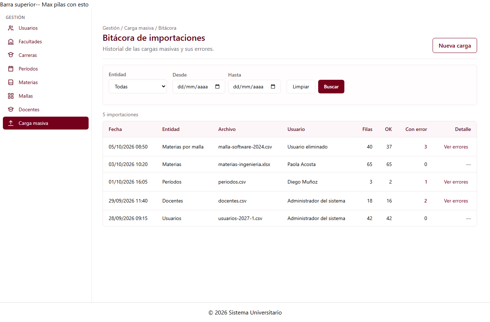

# Bitácora de importaciones (C1-56)

Guía para el equipo. Explica la página que muestra el historial de la carga masiva.

---

## 1. Qué es

Es una página con el historial de todas las importaciones hechas con la carga masiva, con el
detalle de las filas que no se importaron.

| Dato                 | Valor                                                  |
| -------------------- | ------------------------------------------------------ |
| ID                   | C1-56                                                  |
| Selector             | `app-bitacora-importaciones`                           |
| Clase                | `BitacoraImportacionesComponent`                       |
| Tipo                 | Página                                                 |
| **Ruta**             | **`/gestion/carga-masiva/bitacora`**                   |
| Grupo dueño          | G1 · Gestión (Jose Luis Hidalgo)                       |
| Carpeta              | `src/app/features/gestion/bitacora-importaciones/`     |
| `@Input` / `@Output` | Ninguno                                                |
| Datos                | `CargaMasivaService.listarBitacora()`                  |

Lo que ve el usuario:

- Una tabla con fecha (hora de Ecuador), entidad, archivo, usuario y el total de filas, las importadas y las que tuvieron error.
- La lista va **de la importación más reciente a la más antigua**.
- **Ver errores** abre el detalle de cada fila rechazada (número de fila, columna y mensaje). Solo aparece en las importaciones que tuvieron errores.
- Filtros por **entidad** y por **rango de fechas**. Se aplican al pulsar **Buscar** (o Enter), y **Limpiar** los quita.
- Si "Desde" es posterior a "Hasta", el filtro no se aplica y se muestra un aviso.
- Mensajes para cuando está cargando, cuando hay un error (con **Reintentar**) y cuando no hay resultados.

**Cómo se llega:** desde el botón **Ver bitácora** de la página de carga masiva (C1-55) o desde
el enlace **Ver bitácora de importaciones** del resumen final del asistente (C1-54).



---

## 2. Datos

**Modelo** (`src/app/shared/models/bitacora-importacion.model.ts`), según el diagrama de BD:

| Campo           | BD (`importacion_log`)                     |
| --------------- | ------------------------------------------ |
| `id`            | `id`                                       |
| `entidad`       | `entidad`                                  |
| `archivo`       | `archivo`                                  |
| `usuarioId`     | `usuario_id` (nullable, SET NULL)          |
| `usuarioNombre` | *No está en la tabla*: nombre del usuario que devolverá la API. Si es `null`, la tabla muestra "Usuario eliminado" |
| `fecha`         | `fecha` (timestamptz, ISO)                 |
| `totalFilas`    | `total_filas` (= filas_ok + filas_error)   |
| `filasOk`       | `filas_ok`                                 |
| `filasError`    | `filas_error`                              |
| `errores[]`     | Tabla `importacion_error`: `fila`, `columna` (nullable), `mensaje` |

**Servicio:** la hoja indica `CargaMasivaService` (de Julio, C1-50). Con su visto bueno se le
agregó `listarBitacora()`, y `importar()` ahora **registra cada importación** en la bitácora
(entidad, fecha, filas OK/error y un error por cada mensaje de las filas rechazadas). Los datos de prueba están en
`src/app/shared/mocks/bitacora.mock.ts` (TEMPORAL: 5 importaciones ficticias).

---

## 3. Piezas provisionales (TEMPORAL)

| Pieza | Reemplazar por | Cómo |
| ----- | -------------- | ---- |
| Encabezado y botón **Nueva carga** | `app-encabezado-pagina` (C3-23, G3) | El botón va en su zona de acciones |
| Formulario de filtros | `app-barra-filtros` (C4-21, G4) | `[filtrosActivos]="filtrosActivos()" (buscar)="buscar()" (limpiar)="limpiar()"` y proyectar el select de entidad y el rango |
| Campos Desde / Hasta | `app-selector-rango-fechas` (C4-05, G4) | `[(desde)]` y `[(hasta)]` conectados a `rango`. G4 ya valida el rango invertido |
| Tabla | `app-tabla-datos` (C4-20, G4) | Columnas configurables. El detalle de errores va como plantilla de fila |
| Datos | API `GET /api/importaciones` | Cambiar el interior de `listarBitacora()` y quitar `registrarEnBitacora()` (lo hará el servidor) |

Los métodos `buscar()` y `limpiar()` ya responden a las mismas salidas que `app-barra-filtros`
(`buscar`, `limpiar`), y el rango usa la forma `{ desde, hasta }` de G4. Así el reemplazo es directo.

---

## 4. Ruta

Hija de `ShellLayout` en `src/app/app.routes.ts`:

```ts
{
  path: 'gestion/carga-masiva/bitacora',
  loadComponent: () =>
    import('./features/gestion/bitacora-importaciones/bitacora-importaciones').then(
      (m) => m.BitacoraImportacionesComponent,
    ),
},
```

---

## 5. Archivos

```
src/app/features/gestion/bitacora-importaciones/
├── bitacora-importaciones.ts          ← clase de la página
├── bitacora-importaciones.html        ← plantilla (Tailwind, tokens de la paleta)
└── bitacora-importaciones.spec.ts     ← 13 pruebas
src/app/shared/
├── models/bitacora-importacion.model.ts   ← RegistroImportacion, ErrorRegistrado
├── mocks/bitacora.mock.ts                 ← datos ficticios (TEMPORAL)
├── services/carga-masiva.service.ts       ← + listarBitacora() y registro en importar()
└── services/carga-masiva-bitacora.spec.ts ← 6 pruebas del registro
```

Además se agregaron los enlaces a la bitácora en C1-54 (`resumen-importacion`) y en C1-55
(`carga-masiva-pagina`).

---

## 6. Pruebas

`bitacora-importaciones.spec.ts` verifica que:

- se muestran el título y el enlace **Nueva carga**;
- la lista va de la más reciente a la más antigua, con la fecha en hora de Ecuador, el archivo, el usuario y los conteos;
- aparece "Usuario eliminado" cuando `usuarioId` es `null`;
- **Ver errores** solo aparece donde hay errores, y abre y cierra el detalle con fila, columna y mensaje (con `aria-expanded`);
- los filtros se aplican al pulsar **Buscar**, no antes;
- el filtro por entidad y por rango de fechas incluye los extremos;
- un rango invertido no se aplica y muestra un aviso;
- cuando no hay resultados se muestra un mensaje, y **Limpiar** quita los filtros;
- el contador se anuncia con `aria-live`;
- si falla la carga aparece el error, y **Reintentar** vuelve a pedir los datos;
- la ruta `/gestion/carga-masiva/bitacora` funciona.

Ejecutar: `npm test`.

---

## 7. Advertencias

| Tema | Detalle |
| ---- | ------- |
| **Archivo y usuario provisionales** | Cada importación hecha en el prototipo se registra en la bitácora ("… confirmar → registrar en bitácora", como pide el docx). Pero el **archivo** aparece como "(nombre no disponible)", porque `app-subir-archivo` (C4-22, G4) no entrega el nombre, y el **usuario** como "Usuario de prueba", porque aún no existe el login (C1-05). Ambos están marcados TEMPORAL en `carga-masiva.service.ts`. |
| **La bitácora se reinicia al recargar** | En el prototipo vive en memoria: al recargar la página vuelve a los 5 registros de prueba. |
| **Pruebas de quien use el asistente** | El resumen (C1-54) ahora tiene un enlace, así que toda prueba que cree `app-carga-masiva` necesita `provideRouter([])`. Ya se agregó en la prueba del asistente. G2 y G3 deben tenerlo en cuenta. |
| **Permisos** | La bitácora está bajo `/gestion`. Si un usuario de G2 o G3 llega desde el enlace del resumen y no tiene permiso, el guard (cuando exista) lo mandará a `/acceso-denegado`. |
