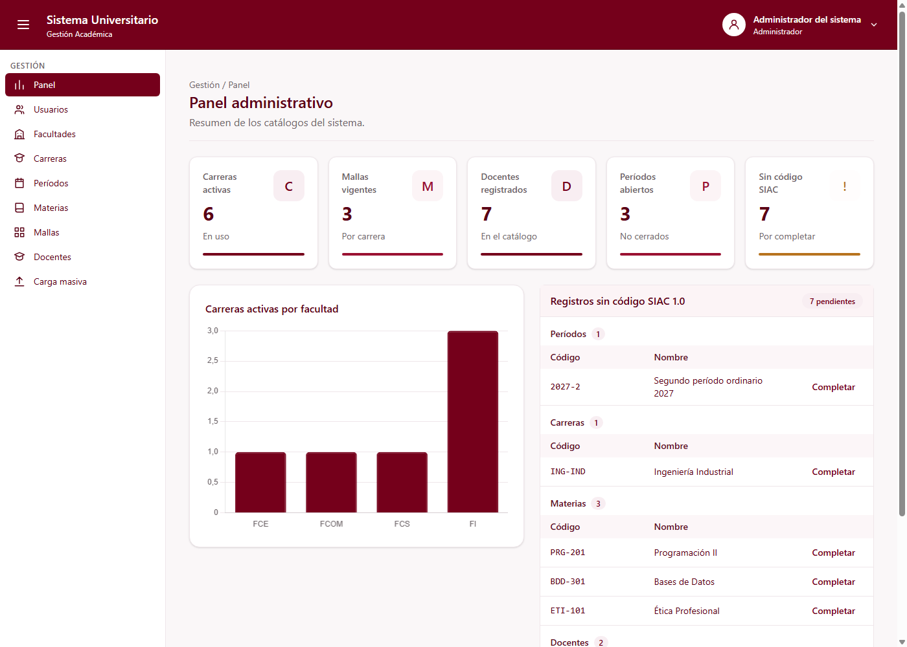

# Panel administrativo (C1-60)

Guía para el equipo. Explica la página de inicio del Administrador, con los indicadores de los
catálogos de Gestión.

---

## 1. Qué es

Es una página con los indicadores básicos que pide el documento del proyecto: "carreras activas,
mallas vigentes, docentes registrados, períodos abiertos y conteo de registros sin código SIAC 1.0".

| Dato                 | Valor                                                  |
| -------------------- | ------------------------------------------------------ |
| ID                   | C1-60                                                  |
| Selector             | `app-panel-administrativo`                             |
| Clase                | `PanelAdministrativoComponent`                         |
| Tipo                 | Página                                                 |
| **Ruta**             | **`/gestion/panel`**                                   |
| Grupo dueño          | G1 · Gestión (Jose Luis Hidalgo)                       |
| Carpeta              | `src/app/features/gestion/panel-administrativo/`       |
| `@Input` / `@Output` | Ninguno                                                |
| Datos                | `PanelService.resumen()`                               |
| Permiso              | `panel.ver` (opción **Panel** del menú de Gestión)     |

Lo que ve el usuario:

- **5 tarjetas** (`app-tarjeta-indicador`, C5-19, G5): carreras activas, mallas vigentes, docentes
  registrados, períodos abiertos (en planificación o activos) y registros sin código SIAC.
- Un **gráfico de barras** (`app-grafico`, C5-20, G5) con las carreras activas de cada facultad activa.
- La **lista de registros sin código SIAC** (`app-registros-sin-siac`, C5-26, G5), agrupada por entidad.
- Al hacer clic en una tarjeta va a la página de ese catálogo. La de "Sin código SIAC" baja hasta la lista.
- Mensajes para cuando está cargando y cuando hay un error (con **Reintentar**).

**Cómo se llega:** desde la opción **Panel** del menú lateral, la primera del grupo Gestión.



---

## 2. Datos

**Modelo** (`src/app/shared/models/panel.model.ts`):

```ts
interface ResumenPanel {
  carrerasActivas: number;
  mallasVigentes: number;
  docentesRegistrados: number;
  periodosAbiertos: number;     // estado distinto de CERRADO
  registrosSinSiac: number;
  carrerasPorFacultad: { facultad: string; carreras: number }[];   // para el gráfico
}
```

**Servicio:** `PanelService` (`src/app/shared/services/panel.service.ts`), el que indica la hoja.
Hoy calcula los números juntando los servicios de cada catálogo:

| Indicador | De dónde sale |
| --------- | ------------- |
| Carreras activas | `CarreraService.listar({ soloActivas: true })` |
| Mallas vigentes | `MallaService.listar()`, las que tienen `vigente: true` |
| Docentes registrados | `DocenteService.listar()` |
| Períodos abiertos | `PeriodoService.listar()`, las que no están `CERRADO` |
| Sin código SIAC | `SiacService.registrosSinCodigo()` (G5): el mismo que usa la lista, para que el número cuadre |
| Gráfico | Carreras activas agrupadas por `FacultadService.listar({ soloActivas: true })` |

Cuando exista backend, `resumen()` pasa a ser una sola llamada (`GET /api/panel/resumen`) y la
página no cambia.

---

## 3. Piezas provisionales (TEMPORAL)

| Pieza | Reemplazar por | Cómo |
| ----- | -------------- | ---- |
| Encabezado | `app-encabezado-pagina` (C3-23, G3) | Título "Panel administrativo" y migas "Gestión / Panel" |
| Navegación de las tarjetas | — | Solo navega si la página ya existe. Hoy funciona **Períodos**; Carreras (C1-23), Mallas (C1-32) y Docentes (C1-40) se activan solas cuando esas rutas existan |
| Clic de la tarjeta | — | La salida de `app-tarjeta-indicador` se llama `click`, igual que el clic del navegador, y llegaban los dos. El panel atiende solo el del navegador. Si G5 renombra la salida, no hay que cambiar nada |

---

## 4. Ruta, menú y permiso

Hija de `ShellLayout` en `src/app/app.routes.ts`:

```ts
{
  path: 'gestion/panel',
  loadComponent: () =>
    import('./features/gestion/panel-administrativo/panel-administrativo').then(
      (m) => m.PanelAdministrativoComponent,
    ),
},
```

- **Menú** (`src/modules/gestion/gestion.menu.ts`): opción **Panel**, primera del grupo Gestión,
  con el ícono de reportes.
- **Permiso**: `panel.ver`, nuevo en `PermisoService`. En la configuración predeterminada solo lo
  tiene el **Administrador**. También se agregó a la lista provisional de `app.config.ts` para que
  la opción aparezca en el menú del prototipo.

---

## 5. Archivos

```
src/app/features/gestion/panel-administrativo/
├── panel-administrativo.ts          ← clase de la página
├── panel-administrativo.html        ← plantilla (Tailwind, tokens de la paleta)
└── panel-administrativo.spec.ts     ← 8 pruebas
src/app/shared/
├── models/panel.model.ts            ← ResumenPanel, CarrerasPorFacultad
├── services/panel.service.ts        ← PanelService.resumen()
└── services/panel.service.spec.ts   ← 7 pruebas
```

---

## 6. Pruebas

`panel-administrativo.spec.ts` verifica que:

- se muestran las 5 tarjetas de la hoja con su título, valor, ícono y texto;
- el gráfico recibe las carreras activas por facultad, en barras;
- está la lista de registros sin código SIAC;
- se avisa mientras carga, y si falla aparece el error y **Reintentar** vuelve a pedir los datos;
- una tarjeta lleva a su página si existe (una sola vez) y no hace nada si la página aún no existe;
- desde la lista sin SIAC se va a la página de la entidad;
- la ruta `/gestion/panel` funciona.

El gráfico y la lista de G5 se reemplazan por sustitutos en estas pruebas: el gráfico necesita un
`<canvas>` real y la lista tiene su propio servicio.

`panel.service.spec.ts` verifica cada indicador con los datos de prueba (6 carreras activas,
3 mallas vigentes, todos los docentes, 3 períodos abiertos, los mismos registros sin SIAC que
la lista) y la agrupación por facultad.

Ejecutar: `npm test`.

---

## 7. Advertencias

| Tema | Detalle |
| ---- | ------- |
| **Datos de G5 en la lista sin SIAC** | `app-registros-sin-siac` usa los datos de prueba de `SiacService` (G5), que no son los mismos de los catálogos de G1 (por ejemplo, su carrera ING-IND tiene id 3; en `CarreraService` es la 6). Se resuelve solo cuando todo venga del backend. |
| **Escala del gráfico** | El eje del gráfico de G5 muestra decimales (0,5; 1,5…) aunque los valores sean enteros. Es una opción de `app-grafico`. |
| **Permisos** | Hasta que exista el login (C1-05), el menú usa la lista provisional de `app.config.ts`. |
